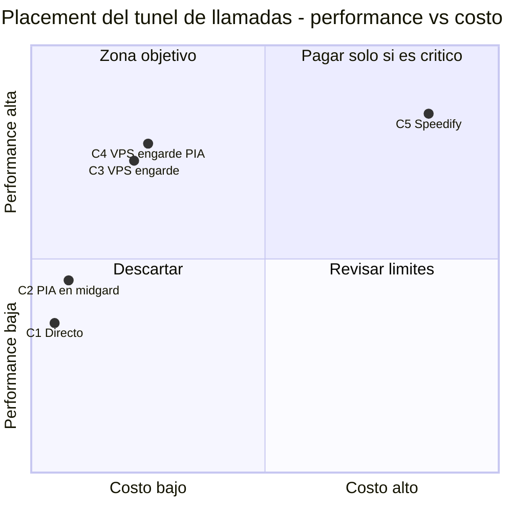
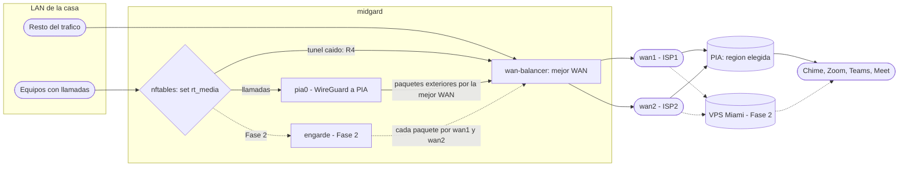

# ADR-0009: Túnel para las llamadas, con PIA en midgard y un VPS propio como evolución multirregión

* **Estado:** accepted
* **Fecha:** 2026-10-21
* **Decisores:** Jeremi
* **Fase AI-DLC:** 02-design
* **Versión:** 1.1.0
* **ID:** ADR-0009
* **Supersede / Superseded-by:** —
* **Controles OWASP afectados:** A02 (cifrado en tránsito del túnel), A05 (ningún puerto nuevo en midgard), A07 (credenciales de PIA en un fichero de root 600 que escribe Jeremi, nunca en el repo; clave privada y token solo en memoria), A09 (estado del túnel en Heimdall)

## Contexto

Del 19 al 21 de octubre wan2 perdió un 15-30 % de los paquetes, y una llamada de Slack de Jeremi sufrió esa
pérdida. El PR #84 (fusionado el 2026-10-21) ya saca de la ruta una WAN que pierde paquetes, y a las 14:31:27 UTC
sacó wan2 con 4 de 48 ping perdidos. Quedan tres problemas que ningún balanceador resuelve:

1. **Un cambio de WAN corta las conexiones que ya existían.** Su NAT apunta a la IP de la WAN anterior, y la
   aplicación tiene que reconectar.
2. **La pérdida de la WAN que queda pasa entera a la llamada.** Si la WAN sana también se degrada, o si las dos
   pierden a la vez, no hay a dónde ir.
3. **Cortes de las dos a la vez.** Bajones de luz en los módems, como el del 2026-10-18 a las 22:52 (5 min). Esto
   solo lo mitiga un SAI, no un túnel.

**Hallazgo del 2026-10-21.** El flujo de la llamada iba de 192.168.10.74 (el PC de Jeremi) a `102.129.153.49:8080`
por UDP. Esa IP está en el mismo bloque que el servidor WireGuard de PIA `us_florida` (`102.129.152.166`) y
responde en el 1337, el puerto de la API de WireGuard de PIA. El 8080/UDP es uno de los puertos de OpenVPN de
PIA. **El PC ya salía por PIA.** Todo su tráfico era un único flujo UDP; el hash del multipath lo puso en wan2,
y la llamada entera viajó por la WAN que perdía paquetes. Un túnel en el PC no elige WAN; uno en midgard, sí.

Jeremi tiene una cuenta activa de Private Internet Access (PIA) y propone combinarla con un VPS en un esquema
multirregión.

### Medición desde midgard (2026-10-21, ~15:35 UTC)

`deploy/host/medir-tuneles.sh`: ping con el origen fijado a cada WAN, 30 paquetes a 0,2 s, contra el primer servidor WireGuard de cada región en
la lista pública de PIA (`serverlist.piaservers.net/vpninfo/servers/v6`). En ese momento wan2 estaba degradada y
fuera de la ruta.

| Destino | Tipo | wan1: pérdida, RTT medio | wan2: pérdida, RTT medio |
|---|---|---|---|
| PIA `bogota` (154.47.16.194) | física | 0 %, **21,5 ms** | 13 %, 67,0 ms |
| PIA `venezuela` (135.136.68.237) | virtual (geo) | 0 %, 47,8 ms | 13 %, 37,8 ms |
| PIA `panama` (135.136.72.77) | virtual (geo) | 0 %, 50,8 ms | 13 %, 36,6 ms |
| PIA `us_atlanta` (72.9.243.9) | física | 0 %, 62,8 ms | 13 %, 51,5 ms |
| PIA `us_florida` (102.129.152.166) | física (Miami) | 0 %, 64,8 ms | 10 %, 46,3 ms (mínimo 33,5) |
| PIA `mexico` (158.173.164.153) | física | 0 %, 111,9 ms | 17 %, 115,3 ms |
| `app.chime.aws` (3.170.170.56) | Amazon Chime, que usa Slack | 0 %, 53,8 ms | 17 %, 35,9 ms |
| `1.1.1.1` | referencia | 0 %, 55,9 ms | 13 %, 37,0 ms |

Lecturas:
- **Las dos WAN llegan a cada región por caminos distintos.** wan1 sale muy cerca de Bogotá (21 ms) y lejos de
  Miami (65 ms); wan2, al revés. La mejor región depende de qué WAN lleve el túnel.
- **Las regiones «virtuales» de PIA (Venezuela y Panamá) quedan a medio camino en las dos.** Su ubicación física
  no está publicada.
- **Falta el tramo de la salida al destino.** La latencia real de una llamada es midgard → salida de PIA →
  servidor de Chime. Solo se puede medir con el túnel levantado, y es la primera tarea del piloto.

## Requisitos de la decisión

- **R1.** Una llamada sobrevive a un cambio de WAN con un corte de menos de 1 s, sin reconectar.
- **R2.** Opcional, en una segunda fase: una llamada tolera una pérdida del 20 % en una de las dos WAN.
- **R3.** Solo el tráfico de tiempo real va por el túnel. El resto sigue directo, y en especial los servicios
  venezolanos (banca), que suelen bloquear IPs extranjeras.
- **R4.** Si el túnel cae, las llamadas vuelven a salir directo. Se prefiere la disponibilidad a la privacidad;
  no hay kill switch.
- **R5.** Las credenciales viven en Andvari y no se imprimen nunca. Heimdall ve el estado del túnel.

## Candidatos evaluados (PxD)

Componente de clase **E**: tiene que originarse en las WAN de la casa. Los pesos de la guía se adaptan:
*Escalabilidad* pasa a ser *Continuidad al cambiar de WAN* (R1 y R2), que es lo que importa aquí.

| Criterio (peso) | C1 Directo (estado actual + #84) | C2 PIA en midgard | C3 VPS + engarde | C4 VPS + engarde + PIA (multirregión) | C5 Speedify Router |
|---|---|---|---|---|---|
| Pérdida y latencia percibidas (30 %) | 2 | 3 | 5 | 5 | 5 |
| Continuidad al cambiar de WAN (20 %) | 1 | 4 | 5 | 5 | 5 |
| Disponibilidad (15 %) | 3 | 3 | 3 | 5 | 4 |
| Límites técnicos (15 %) | 5 | 3 | 4 | 4 | 3 |
| Carga operativa (20 %) | 5 | 3 | 2 | 1 | 4 |
| **Score_perf** | 3,00 | 3,20 | 3,95 | 4,05 | 4,35 |
| **Costo incremental USD/mes** | 0 | 0 (PIA ya pagado) | ~5-6 | ~5-6 | 25-45 |
| **PxD** | 30,0 | **32,0** | ~6,6 | ~6,8 | ~1,0-1,7 |

Costo normalizado a un mínimo de 1 USD, como dice la guía. C3 y C4 se calculan con 6 $/mes; C5, con los dos extremos de su rango.

Fuentes de precios, consultadas el 2026-10-21. **Se verifican antes de contratar.**
- **VPS.** Los agregadores (costbench, toolradar) dan la entrada de Vultr Cloud Compute en 2,50-5 $/mes y la
  documentación de Vultr cobra 0,01 $/GB de exceso. Las llamadas son unos pocos GB al mes.
- **Speedify.** `speedify.com/pricing`: Router 1 TB 25-30 $/mes, 3 TB 37,50-45 $/mes.

Puntuaciones:
- **C2.** No protege de la pérdida de la WAN que lleva el túnel. Sí da continuidad: WireGuard «roamea» al nuevo
  origen y la IP de salida no cambia. Límites:
  - la API de PIA con tokens que caducan;
  - las IPs compartidas;
  - los scripts oficiales `pia-foss/manual-connections`, que sus propios autores no recomiendan para uso crítico.
- **C3.** engarde duplica cada paquete de WireGuard por las dos WAN. Gana el primero que llega y WireGuard descarta
  la copia por su ventana anti-repetición. Sin respaldo, el VPS es un punto único de fallo.
- **C4.** C3 con PIA de respaldo del VPS y como segunda región. Es la de más disponibilidad y la de más piezas.
- **C5.** Hace lo mismo que C4 con un servidor de terceros. Es la más cara.

Descartados sin puntuar:
- **OpenMPTCProuter.** El router es su propia imagen OpenWrt: habría que sustituir Ubuntu en midgard. Su script
  de VPS no admite Ubuntu 24.04.
- **WireGuard o Tailscale solos.** No hacen multipath.
- **MPTCP.** Solo cubre TCP, y las llamadas van por UDP.

*Eje decisión · fase 02 · performance (Score_perf) frente a costo incremental.*

## Decisión

**Por fases. La Fase 1 es C2, el mayor PxD. La Fase 2 es C4 y solo se activa si los datos de la Fase 1 lo
justifican.**

### Decisión de Jeremi (HITL 2026-10-21)

Jeremi acepta la ADR con un cambio en el alcance de la Fase 1:

- **Por equipo, no por tipo de tráfico.** Todo el tráfico del PC de Jeremi sale por el túnel, no solo el de
  llamadas. El equipo se elige por su MAC, que vive en `/etc/yggdrasil-pia.conf` y no en el repositorio, que es
  público. Elegirlo por MAC sigue funcionando aunque DHCP le cambie la IP.
  - Su DNS va al de PIA, así que el ISP deja de ver sus consultas.
  - Su IPv6 hacia fuera se descarta, porque PIA solo da IPv4. Hoy la LAN no tiene IPv6 global.
  - La clasificación `rt_media` queda **aplazada**. Se retoma si hace falta para otros equipos.
- **T12 aceptada:** PIA puede ver los metadatos del tráfico del PC.
- **El PC deja de usar la app de PIA** una vez configurado el túnel en midgard.
- **R4 se mantiene:** si el túnel no responde, el PC sale directo. No hay kill switch.
- **Credenciales en `/etc/yggdrasil-pia.env`** (root, 600), que escribe Jeremi y no Claude, en vez de en
  Andvari. Andvari todavía no tiene cómo entregar secretos a los servicios del host; cuando lo tenga, se migran.
- **Región inicial `us_florida`**, la que ya usaba la app del PC. Se cambia con `PIA_REGION`.
- **Implementación:** `deploy/host/pia-tunel.sh` y `pia-tunel.service`, documentados en `deploy/host/README.md`
  («Túnel PIA»).
  - El camino exterior del túnel sigue la ruta por defecto que mantiene wan-balancer, sin reglas propias.
  - Thor publica el estado del túnel, y hay dos alertas: `TunelPiaSinDesvio` y `TunelPiaCaido`.

*Eje comportamiento · fase 02 · camino del tráfico de llamadas.*

### Fase 1: PIA en midgard (C2), diseño propuesto

Lo que sigue es el diseño de la propuesta. Donde difiere, manda la decisión HITL de arriba.

- **Interfaz `pia0`** (WireGuard) hacia una sola región de PIA.
  - Un temporizador systemd pide el token y registra la clave por la API de PIA, partiendo de
    `pia-foss/manual-connections` revisado línea a línea.
  - Usuario y contraseña de PIA en Andvari. Jeremi los introduce; el script los lee del entorno y los envía al
    token sin escribirlos en disco ni en el journal.
- **Región:** la elige el piloto por RTT total hasta Chime con el túnel levantado. Candidatas: `us_florida`
  (física, en Miami), `venezuela` y `panama` (virtuales, equilibradas en las dos WAN) y `bogota`. Se usa siempre
  la misma: cambiar de región cambia la IP de salida y corta las llamadas.
- **Clasificación:**
  - Un set de nftables `rt_media` con los rangos publicados de cada servicio:
    - Amazon Chime, que usa Slack: 99.77.128.0/18.
    - Teams: 52.112.0.0/14 y 52.122.0.0/15.
    - Meet: 74.125.250.0/24, 74.125.247.128/32 y 142.250.82.0/24.
    - Zoom: la lista de `assets.zoom.us`.
  - Más los puertos UDP 3478-3481, 8801-8810, 19302-19309 y 22466.
  - Solo flujos nuevos desde la LAN: se marcan y una regla `fwmark` los manda a la tabla del túnel.
- **Camino exterior:** `pia0` lleva su propia `fwmark`, y wan-balancer apunta la regla de esa marca a la WAN que
  esté en la ruta. Si están las dos, a la de menos pérdida en la ventana. Al cambiar de WAN, WireGuard roamea y
  la llamada sigue (R1).
- **Respaldo (R4):** wan-balancer sondea por `pia0` cada 5 s. Si el túnel no responde, retira la regla de
  `rt_media` y las llamadas salen directo.
- **MTU de `pia0` en 1380**, por el agujero negro de MTU de wan2 (2026-10-06). MSS recortado.
- **Heimdall:**
  - sondas ICMP y TLS por `pia0`;
  - métrica de estado del túnel publicada por Thor;
  - alerta `TunelLlamadasCaido` (warning, 5 min).
- **El PC deja de usar la app de PIA para las llamadas.** Si no, su túnel envuelve todo en un único flujo UDP que
  `rt_media` no reconoce, y midgard no lo puede tratar.

### Fase 2: VPS propio con engarde (C4), solo si la Fase 1 no basta

- VPS KVM en Miami con Debian 12. WireGuard y el servidor de engarde, y solo sus puertos UDP abiertos.
- midgard corre el cliente de engarde: cada paquete de `rt_media` sale por wan1 **y** por wan2 (R2).
- Prioridad para las llamadas: VPS, si cae PIA, y si cae, directo.
- Multirregión: la segunda región de PIA medida (hoy, `bogota` por wan1) como tercera salida.
- **Endurecimiento del VPS:** actualizaciones automáticas, SSH solo con clave y desde el túnel, y sus claves en
  Andvari.

## Alternativas consideradas

Las cinco de la matriz más las descartadas. Tres variantes de C2:

- **La app de PIA en cada equipo.** Es lo que pasaba el 21 de octubre. Cubre un dispositivo, no elige WAN y
  envuelve todo el tráfico.
- **Un túnel de PIA por WAN.** Cada sesión tiene otra IP de salida, así que pasar de uno a otro corta la llamada,
  igual que hoy.
- **Encadenar el VPS a PIA.** Suma latencia y no aporta continuidad ni tolerancia a pérdida.

## Consecuencias

- **Positivas:**
  - Fase 1 sin costo nuevo.
  - Las llamadas sobreviven a los cambios de WAN que ahora hace más a menudo el balanceador del PR #84.
  - midgard gana control sobre el tráfico de tiempo real de todos los equipos, móviles incluidos.
- **Negativas:**
  - PIA ve los metadatos de las llamadas (destino, volumen, horario). Hay que anotarlo en `data-classification.md`.
  - Una IP compartida puede traer captchas.
  - Hay código nuevo en el host: el temporizador de PIA y la tabla del túnel.
  - La Fase 2 añade un servidor que mantener.
- **Threat model:** T11 y T12 añadidas a `threat-model.md` el 2026-10-21; T13, con la Fase 2.

  | ID | Amenaza | Control previsto |
  |---|---|---|
  | T11 | Las credenciales de PIA en midgard | Fichero de root 600, leído sin `source`, pasado a curl por descriptor; token y clave privada nunca en disco |
  | T12 | PIA como observador de los metadatos del tráfico del PC | Riesgo aceptado por Jeremi (HITL 2026-10-21) |
  | T13 | Un VPS comprometido (Fase 2) | Solo transporta tráfico ya cifrado por la aplicación: SRTP o DTLS en las llamadas |

- **No cubre los cortes de las dos WAN a la vez.** Para eso sigue pendiente el SAI de midgard y de los dos módems.

## Condiciones de revisión

- **Tras 30 días de Fase 1:**
  - Si las llamadas pasan más de 30 min al mes con pérdida ≥ 1 % por el túnel, se propone la Fase 2.
  - Si la calidad por PIA es peor que la directa, se revierte. Slack recomienda no meter las huddles en VPN; se
    mide, no se supone.
- PIA cambia su API o sus condiciones de uso en routers.
- Llega un SAI: se reevalúa el peso de la disponibilidad.
- Los precios de VPS citados caducan el 2027-04-21.

### Proceso de revisión (2026-11-20)

La revisión a 30 días está programada y se apoya en datos, no en memoria:

1. **Medición continua.** `pia-tunel.sh` cuenta las sondas a `1.1.1.1` por el túnel. Solo cuentan las que se hacen
   con el desvío activo: miden lo que vive el PC, no un túnel sin usar. También cuenta las sin respuesta, su RTT,
   los levantamientos del túnel y los rechazos de PIA. Thor lo publica como `yggdrasil_pia_sondas_total`,
   `yggdrasil_pia_sondas_perdidas_total`, `yggdrasil_pia_rtt_ms`, `yggdrasil_pia_levantamientos_total` y
   `yggdrasil_pia_rechazos_total`. Heimdall ya sondea `1.1.1.1` por cada WAN, así que la comparación es con el
   mismo destino.
2. **Informe automático.** `yggdrasil-revision-adr-0009.timer` (2026-11-20 09:00, Caracas, `Persistent`) ejecuta
   `deploy/cd/revisar-adr-0009.sh --aviso`.
   - Aplica los criterios de arriba sobre 30 días de Mimir.
   - La referencia es la WAN directa que menos pierde, que es la que usa la casa.
   - Manda el informe por ntfy y lo guarda en `/var/lib/yggdrasil-revisiones/`.
   - Propone `MANTENER FASE 1`, `PROPONER FASE 2`, `VALORAR REVERTIR`, `DATOS INSUFICIENTES` (menos de 25 días)
     o `SIN DATOS`.
   - Se puede ejecutar a mano en cualquier momento, sin efectos.
3. **Seguimiento en GitHub:** la issue #88 del milestone «Revisión ADR-0009 (2026-11-20)». Lleva la lista de lo
   que el script no mide: cambios en PIA, el SAI y si los servicios venezolanos bloquean el PC.
4. **Decisión HITL.** Jeremi decide. La decisión se anota aquí, con la nota de revisión y la versión, en un PR que
   cierra la #88.

## Fuentes (2026-10-21)

- Medición propia desde midgard: `deploy/host/medir-tuneles.sh` (solo lectura: ping y TCP con origen fijado a cada WAN).
- Lista de servidores de PIA: https://serverlist.piaservers.net/vpninfo/servers/v6
- Conexión manual a PIA: https://github.com/pia-foss/manual-connections
- Red de Slack para huddles: https://slack.com/help/articles/36284146785427-Guide-to-network-and-system-configuration-for-Slack-huddles
- Zoom: https://support.zoom.com/hc/en/article?id=zm_kb&sysparm_article=KB0060548
- Microsoft 365 (Teams): https://learn.microsoft.com/en-us/microsoft-365/enterprise/urls-and-ip-address-ranges
- Google Meet: https://knowledge.workspace.google.com/admin/meet/prepare-your-network-for-meet-meetings-and-live-streams
- engarde: https://github.com/porech/engarde
- OpenMPTCProuter (VPS): https://github.com/Ysurac/openmptcprouter-vps
- Speedify: https://speedify.com/pricing/
- Vultr (agregadores): https://www.costbench.com/software/cloud-infrastructure/vultr/
