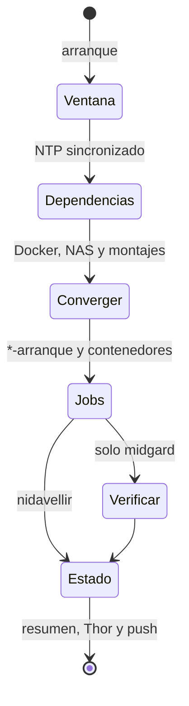

# ADR-0011: Baldr, protocolo tras un apagón en midgard y nidavellir

* **Estado:** accepted
* **Fecha:** 2026-10-28
* **Decisores:** Jeremi
* **Fase AI-DLC:** 05-deployment
* **Versión:** 1.0.0
* **ID:** ADR-0011
* **Supersede / Superseded-by:** —
* **Controles OWASP afectados:** A05 (sin puertos ni contenedores nuevos; la configuración de cada host no va al repositorio), A09 (el resultado de cada arranque queda en Mimir, en una alerta y en un push)

## Contexto
midgard no tiene UPS. El 2026-10-28 la luz se fue a las 04:03 UTC y volvió a las 11:50 (7 h 47 min).
Los dos hosts arrancaron solos, pero el arranque dejó cosas mal sin que nada avisara:

| Qué | Causa | ¿Avisó? |
|---|---|---|
| `yggdrasil-arranque` falló (también el 2026-10-24) | Nornas aún no estaba sano cuando `compose up` lo esperaba; no reintenta | No |
| `ves-market-arranque` falló | `ves-timescaledb` aún no estaba sana: el mismo patrón | No |
| `ves-market-respaldo-nas` falló | `Persistent=true` lo lanzó al arrancar, antes de que respondiera el NAS | Push |
| `/mnt/nas/descargas` falló y `transmission` quedó `Exited (128)` | El NAS tardó más que el timeout del montaje; systemd no reintenta | No |
| `FafnirInventarioViejo` ×3 | El catálogo corrió al arrancar, antes de que hubiera inventarios | Alerta |
| `SleipnirSinMedicion` | 8 h sin medir; Sleipnir alterna WAN cada 3 h | Alerta |

Además, midgard arrancó con el reloj en el **2026-10-12** hasta que NTP lo corrigió: la pila del CMOS no
guarda la hora durante un corte. Cualquier cálculo de la ventana del apagón tiene que esperar a NTP.

Cada pieza tenía ya su arranque (ADR-0005 de Bragi, TA-13 de la 0.4.9). Lo que faltaba era un **orden**
(primero el NAS, después lo que depende de él) y **alguien que comprobara el resultado**.

## Decisión
**Baldr** (`deploy/cd/yggdrasil-baldr.sh`, unidad `yggdrasil-baldr.service`) corre una vez tras cada
arranque, en midgard y en nidavellir, con la configuración de cada host en `/etc/default/yggdrasil-baldr`
(ejemplo: `deploy/cd/yggdrasil-baldr.ejemplo`). En la mitología, Baldr es el dios que vuelve del reino de
los muertos.

1. **Ventana.** Espera a NTP. La caída es la última entrada del registro del arranque anterior; si sus
   últimas líneas no son la secuencia de apagado, fue un corte.
2. **Dependencias.** Docker, el NAS (`BALDR_NAS`, puerto NFS) y los montajes de `BALDR_MONTAJES`. Un
   montaje que falló por timeout se reintenta.
3. **Converger.** Las unidades `*-arranque` habilitadas que no terminaron bien se reintentan. Los
   contenedores con política de reinicio que **murieron durante este arranque** con código distinto de 0
   se arrancan. Uno parado a mano antes del apagón no se toca: `unless-stopped` es justo eso.
4. **Jobs pendientes** (decisión de Jeremi: relanzar solo los declarados). De `BALDR_JOBS`, se relanzan
   los que corrieron en este arranque **antes** de que las dependencias estuvieran listas, o que fallaron.
   Los temporizadores con `Persistent=true` ya lanzan al volver lo que el apagón se comió; el fallo es que
   lo lanzan demasiado pronto. Todos los declarados son idempotentes (respaldos, Fáfnir). Los contenedores
   de `BALDR_CONTENEDORES` se reinician tras un corte: Sleipnir mide al arrancar.
5. **Verificar** (solo midgard, que tiene Mimir; no antes de 15 min desde el arranque):
   - las alertas activas, separando las esperables (`BALDR_ESPERADAS`: `HostReiniciado`,
     `SleipnirSinMedicion`) de las demás;
   - lo que Thor publica de los otros hosts;
   - las unidades que sigan fallidas en midgard.

**Resultado** (decisión de Jeremi: push y Hlidskjalf):
- Un **push por ntfy** con el resumen si hubo corte o si queda algo pendiente. Sale por el canal de
  avisos del host (`/etc/yggdrasil-aviso.env`), no por Gjallarhorn, para no depender del stack que acaba
  de volver.
- `/var/lib/yggdrasil-baldr/resumen`, legible, y `estado`, que Thor publica en Mimir
  (`yggdrasil_baldr_*`).
- `BaldrConPendientes` (12 h) y `BaldrSinTerminar` salen en el panel de alertas de Hlidskjalf como
  cualquier otra.
- Revisión a mano tras arreglar algo: `sudo yggdrasil-baldr.sh verificar`. Solo verifica: no relanza
  nada ni avisa.

**Causas de raíz** (decisión de Jeremi: arreglarlas también):
- `yggdrasil-arranque.service` reintenta solo (`Restart=on-failure`, 5 veces en 20 min).
- Thor publica las unidades `failed` (`yggdrasil_unidad_fallida`) y los contenedores muertos durante el
  arranque (`yggdrasil_contenedor_caido`). Avisan `UnidadFallida` (15 min) y `ContenedorCaido`
  (10 min), sin duplicar lo que ya cubre `yggdrasil_servicio_ok`.
- En ves-market-watch, aparte: su arranque reintenta y el respaldo al NAS espera a que el montaje
  responda.

## Alternativas consideradas
| Opción | Pros | Contras |
|---|---|---|
| **Baldr: una pasada ordenada por arranque** (elegida) | Un solo sitio que conoce el orden; deja rastro y avisa | Una pieza más que mantener en cada host |
| Solo `Restart=` y dependencias de systemd en cada unidad | Sin código nuevo | Cada repo lo resuelve a su manera; nadie comprueba el conjunto ni lo cuenta |
| Relanzar todo lo que falló tras el arranque | Más automático | Puede relanzar algo que no debe; Jeremi prefiere una lista declarada |
| Un UPS | Evita el apagón | Coste; no cubre cuelgues ni reinicios del watchdog de nidavellir. Compatible con Baldr |

## Consecuencias
- Positivas:
  - Tras cada arranque hay un parte con la duración del apagón, lo que se arregló solo y lo que no.
  - Los jobs perdidos corren cuando pueden terminar bien, no al arrancar.
  - Lo que hoy no vigilaba nadie (montajes, contenedores fuera del Compose) avisa.
- Negativas:
  - Un job declarado se puede ejecutar dos veces tras un apagón: una al arrancar, demasiado pronto, y otra
    con Baldr. Por eso solo se declaran idempotentes.
  - `UnidadFallida` avisará de restos viejos que nadie limpió (en nidavellir, las unidades del rescate
    del 2026-10-25): hay que hacer `reset-failed` una vez.
- Seguimiento:
  - Cambiar la pila del CMOS de midgard.
  - Ensayar Baldr con un reinicio controlado de cada host antes del cierre del Gate 4.
