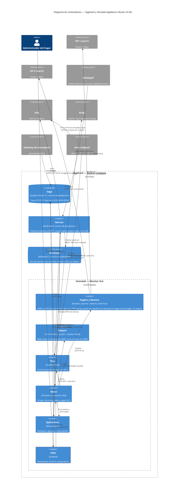
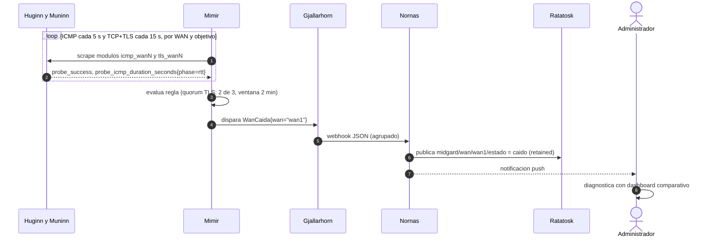
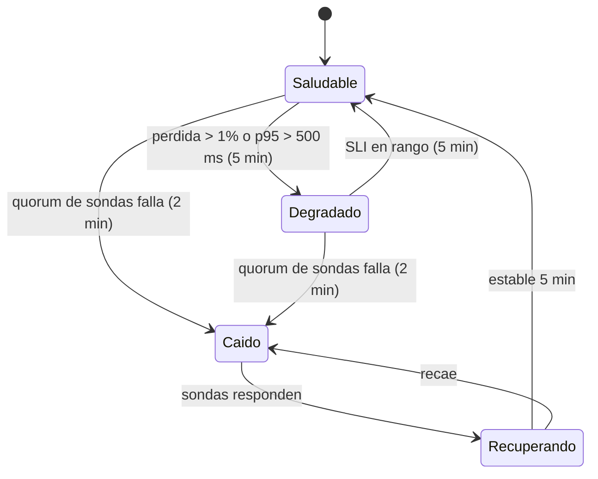
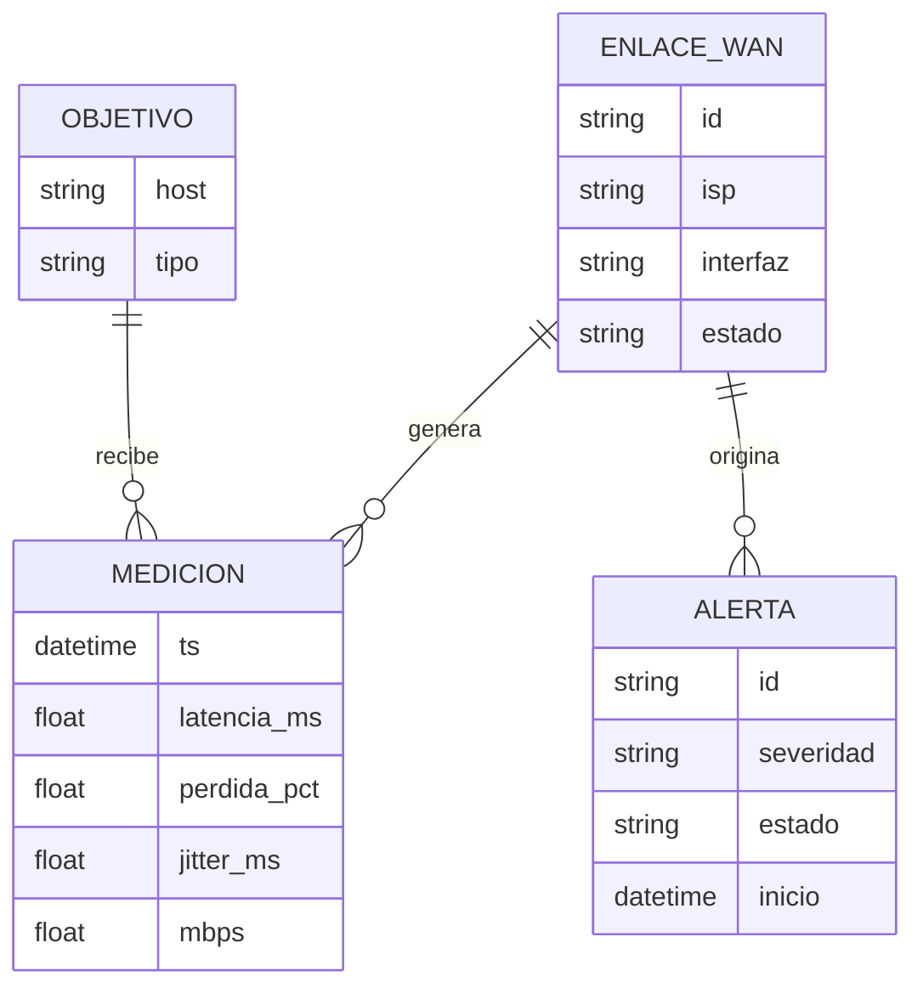
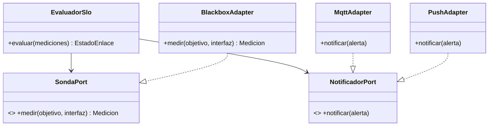

# Diseño del Sistema — Monitor SLA de Internet (Yggdrasil)

* **Estado:** approved
* **Fecha:** 2026-09-01
* **Decisores:** Jeremi
* **Fase AI-DLC:** 02-design
* **Versión:** 0.2.0 (revisión 2026-10-19, al pie)
* **Gate:** 1
* **Estilo arquitectónico:** Contenedores desacoplados por eventos (puertos/adaptadores en el bridge MQTT)
* **ADRs relacionadas:** ADR-0001, ADR-0002, ADR-0003, ADR-0005 (despliegue continuo), ADR-0006 (Ratatosk y Nornas), ADR-0007 (Hlidskjalf)

## Contextos acotados (DDD)
| Bounded Context | Responsabilidad | Entidades núcleo |
|---|---|---|
| Observabilidad SLA | Medir, evaluar SLO, alertar | EnlaceWan, Medicion, Alerta |
| Domótica/Eventos | Reaccionar al estado de los enlaces | TópicoEstado, Automatización |

## Vista C4 — Container

*Eje estructura · fase 02 · evidencia Gate 1.*

Notas de diseño clave:
- **Medición independiente por WAN**: blackbox_exporter define por WAN un módulo ICMP (`icmp_wanN`) y uno TCP+TLS (`tls_wanN`) con `source_ip_address` = IP de la WAN; exige `network_mode: host` (ADR-0003) para ver las interfaces reales y no chocar con el NAT de Docker. El prober http de blackbox no permite fijar la IP de origen, así que la comprobación de aplicación es el handshake TCP+TLS y no un HTTP 204.
- **Objetivos y quórum** (RF01, anti falso-negativo), revisados el 2026-10-06 y el 2026-10-17:
  - **ICMP cada 5 s** a 1.1.1.1, 8.8.8.8 y 208.67.222.222: miden pérdida y latencia. La pérdida del enlace es la **mediana** de los tres objetivos que responden, así que la pérdida de un solo destino no cuenta. A 5 s caben 60 sondas por objetivo en la ventana de 5 min; a 15 s eran 20, un 5 % por sonda con un umbral del 1 %.
  - **TCP+TLS cada 15 s** a `www.gstatic.com:443`, `1.1.1.1:443` y `8.8.8.8:443`: deciden si la WAN está arriba. `wan:up` exige que respondan **≥ 2 de las 3**. El 2026-10-06 wan2 contestaba a los ping con TCP roto, y con dos votos ICMP seguía «arriba»; por eso el quórum es solo TLS. `wan-balancer` y `wan-watchdog` usan los mismos destinos y la misma mayoría (`deploy/host/tests/prueba-quorum.sh`). Desde 2026-10-21 `wan-balancer` saca además una WAN viva que pierde ≥ 3 de 48 ping en 2 min a los objetivos ICMP de Heimdall (`deploy/host/README.md`, «ventana de pérdida»): `wan:up` dice si la WAN está viva; el balanceador, si sirve.
- **Jitter** (RF01): **pendiente de implementar** (decisión HITL del 2026-10-19). Está previsto como `wan:jitter_ms:5m`, la desviación típica del RTT ICMP en 5 min por objetivo y la mediana de los objetivos de cada WAN, como la pérdida. Sleipnir publicará además el jitter que ya le da Ookla.
- **Umbrales SLO y percentiles** (RF03, RF07, RF09): la pérdida > 1 % o el p95 > 500 ms sostenidos 5 min llevan el enlace a Degradado; el p95 > 200 ms solo apaga el indicador `apto_llamadas` (alerta info) sin cambiar el estado, porque una WAN válida para navegar puede no servir para llamadas. La latencia se registra como p90, p95 y p99 por WAN mediante recording rules con `quantile_over_time` sobre `probe_icmp_duration_seconds{phase="rtt"}` (el RTT real; `probe_duration_seconds` incluye resolución y setup) en ventana de 5 min, porque blackbox_exporter expone un gauge por sonda y no un histograma; p90/p99 son series de seguimiento comparativo entre ISP. El throughput se evalúa contra el 80 % del nominal **contratado con cada ISP, por dirección** — no contra un 800 Mbps fijo: el ISP2 vende 1:0.5, así que la subida de wan2 contrata 500 Mbps y su umbral es 400. Los cuatro umbrales viven en la recording rule `wan:slo_throughput_mbps` (wan1 800/800, wan2 800/400); alerta tras dos mediciones consecutivas por debajo. Umbrales confirmados por el owner el 2026-09-05; el desglose por dirección (ISP2 asimétrico 1:0.5) se revisó con el owner el 2026-09-16.
- **Disponibilidad mensual** (RF08): `wan:up` vale 1 cuando el quórum de sondas responde y `hogar:up = max(wan:up)`. La disponibilidad es `avg_over_time` sobre 30 días por WAN y del hogar, materializada como recording rule para que el dashboard y el reporte mensual no dependan de consultas pesadas sobre 30 días de muestras.
- **Throughput** (RF02, RF09): Sleipnir mide cada 3 h alternando WAN (cada WAN, cada 6 h), con la IP de origen de su interfaz. El modo por defecto es la **CLI de Ookla** contra una lista de tres servidores (`SLEIPNIR_MODO=ookla`). En Gate 3 (v0.4.3–v0.4.5) se cambió `speedtest-cli` por la CLI de Ookla; `speedtest` e `iperf3` quedan como modos alternativos (repuestos en la v0.5.11). El resultado va a un fichero de texto que sirve un `busybox httpd` en el 9469. El techo medible de la cadena es ≥ 939 Mbps (calibrado en Gate 3). El panel de throughput de Odín **todavía pinta un umbral fijo de 800**: la subida de wan2, que cumple su SLO de 400, sale en rojo. Pendiente: dibujar `wan:slo_throughput_mbps` como umbral por WAN y dirección.
- **Métricas del host** (Thor): `yggdrasil-thor.sh` corre en el host con un temporizador systemd y escribe `host.prom`; el contenedor Thor solo lo sirve (httpd en el 9471, Mimir lo lee cada 60 s). Incluye: SMART y errores del kernel por disco, montajes y espacio (raíz, SSD de datos y NAS), si cada WAN está en la ruta del balanceador, el estado de los contenedores y unidades del host, la hora del último respaldo de cada proyecto (Yggdrasil, Bifröst, Hermod y Andvari) y el estado del túnel PIA (ADR-0009). Sus 16 alertas están en `thor-alertas.yml` (tabla abajo); detalle en `deploy/cd/README.md`.
- **Observabilidad de Bragi** (Jellyfin, repo `higerotech/bragi`): corre en nidavellir desde su ADR-0010 y Mimir lee su `bragi.prom` en `192.168.10.2:9471` (el httpd de Thor) cada 30 s; 8 alertas en `bragi-alertas.yml`. El diseño vive en el repo de Bragi.
- **Ruta real del hogar** (revisión 2026-09-16): las sondas por WAN fijan `source_ip_address`, así que sus paquetes entran por la regla `ip rule from <ip> lookup wanN` y viajan por una tabla que `wan-balancer` mantiene con default propio. Miden la salud de cada **enlace**, que es su cometido, pero ninguna pasa por la tabla `main`, que es por donde salen la LAN, dnsmasq y los contenedores. El 2026-09-12, de 06:20 a 13:25 UTC, `main` se quedó sin ruta utilizable y la casa estuvo 7 h sin internet mientras `hogar:up` valía 1 y no se disparó ninguna alerta. Los módulos `icmp_hogar` y `tls_hogar` (sin IP de origen) cubren ese camino y alimentan `hogar:ruta_up` y la alerta `HogarSinRuta`. `tls_hogar` cubre además la resolución DNS de extremo a extremo, punto único de fallo compartido por ambas WAN que no se ve en ninguna otra sonda.
- **Servicios de plataforma** (ADR-0006): Ratatosk y Nornas los despliega el propio Compose de Yggdrasil, no un stack externo. Ratatosk exige credencial por cliente (`nornas` e `iot`; el usuario `frigate` se retiró con Fenrir en la 0.5.3) con ACL por tópico; Nornas lleva editor autenticado y recibe el webhook por la red interna. La suma de `mem_limit` es 1680 MB con Thor (16 MB); era 1408 antes de subir el techo de Odín el 2026-09-16. RNF01 no acota esa suma sino la RAM real del stack (≤ 1.5 GB), medida en TA-12: 406 MiB de media y 554 MiB de pico.
- **Tablero de pared** (ADR-0007): Nornas sirve también Hlidskjalf, una página estática y un resumen JSON (`/hlidskjalf/resumen`) que arma con una consulta instantánea a Mimir y las alertas activas de Gjallarhorn, ambas por la red interna; una tablet Android en modo kiosco lo pinta. El resumen exige un token de solo lectura propio. Thor publica para él el estado de los contenedores y unidades y el último respaldo.
- **Estado → MQTT** (RF05): Node-RED transforma el webhook de Alertmanager en `midgard/wan/<id>/estado`, `midgard/wan/<id>/apto_llamadas` y `midgard/hogar/internet/estado` (retained) y en notificación push; la domótica queda desacoplada del stack de métricas.

## Flujos críticos (comportamiento)

*Eje comportamiento · fase 02 · evidencia Gate 1.*

## Ciclo de vida de la entidad núcleo (EnlaceWan)

*Eje comportamiento · fase 02 · evidencia Gate 1.*

El indicador `apto_llamadas` (p95 < 200 ms y pérdida < 1 %) es ortogonal al estado del enlace: se publica aparte y no añade estados a la máquina.

## Modelo de datos y dominio

*Eje estructura · fase 02. En la práctica EvaluadorSlo son las recording/alerting rules de Prometheus; el modelo de puertos guía dónde enchufar nuevas sondas o notificadores.*

## Contratos de API
No hay REST propio; los contratos de la plataforma son las métricas y los eventos.

Métricas (contrato Prometheus):
| Serie | Labels | Significado |
|---|---|---|
| `probe_success` | `wan`, `target`, `module` | 1/0 por sonda |
| `probe_icmp_duration_seconds{phase="rtt"}` | `wan`, `target` | RTT por sonda ICMP; base de los percentiles (`probe_duration_seconds` incluye resolución y setup) |
| `wan:perdida_pct:5m` (recording) | `wan` | Pérdida del enlace: mediana de los 3 objetivos ICMP que responden (la pérdida de un solo destino no cuenta); SLO < 1 % |
| `wan:latencia_p90:5m` (recording) | `wan` | p90 de latencia en 5 min, seguimiento |
| `wan:latencia_p95:5m` (recording) | `wan` | p95 de latencia en 5 min, referencia de SLO |
| `wan:latencia_p99:5m` (recording) | `wan` | p99 de latencia en 5 min, seguimiento |
| `wan:apto_llamadas` (recording) | `wan` | 1 si p95 < 200 ms y pérdida < 1 % en 5 min |
| `wan:jitter_ms:5m` (recording, **pendiente**) | `wan` | Jitter: desviación típica del RTT ICMP en 5 min, mediana de los objetivos (RF01; se implementa tras la 0.5.13) |
| `wan:up` (recording) | `wan` | 1 si responden ≥ 2 de las 3 sondas TCP+TLS de la WAN, 0 si no; base de la disponibilidad |
| `hogar:up` (recording) | — | `max(wan:up)`: 1 si al menos una WAN está operativa |
| `wan:disponibilidad:30d` (recording) | `wan` | `avg_over_time` de `wan:up` en 30 días, disponibilidad mensual por ISP |
| `hogar:disponibilidad:30d` (recording) | — | Disponibilidad mensual de internet del hogar |
| `hogar:ruta_up` (recording) | — | Quórum (2 de 3) de las sondas **sin IP de origen** (2 ICMP + 1 TLS): mide la tabla `main`, la ruta que usa la casa. Complementa a `hogar:up`, que por definición de RF08 mide "al menos una WAN operativa" |
| `hogar:ruta_disponibilidad:30d` (recording) | — | `avg_over_time` de `hogar:ruta_up` en 30 días |
| `wan:slo_throughput_mbps` (recording) | `wan`, `direccion` | Umbral de RF09, 80 % del nominal contratado: wan1 800/800, wan2 800/400 |
| `wan_throughput_mbps` | `wan`, `direccion` | Resultado periódico de throughput; SLO = `wan:slo_throughput_mbps` (RF09) |
| `wan_throughput_medicion_ok` | `wan` | 1 si la última medición de Sleipnir fue válida; condiciona `WanThroughputBajo` |
| `wan_throughput_ultima_medicion_timestamp_seconds` | `wan` | Epoch de la última medición; base de `SleipnirSinMedicion` |
| `wan_throughput_latencia_ms` | `wan` | Latencia reportada por la prueba de throughput (seguimiento); no existe en modo `iperf3`, que no la mide |
| `wan_throughput_medicion_en_curso` | `wan` | 1 mientras Sleipnir mide esa WAN: la prueba satura el enlace y las sondas ven pérdida; Hlidskjalf la usa para no pintarla como avería |
| `yggdrasil_*` (Thor) | varios | Métricas del host: `yggdrasil_smart_*`, `yggdrasil_disco_errores_kernel_15m`, `yggdrasil_disco_rotacional`, `yggdrasil_fs_*`, `yggdrasil_wan_en_ruta`, `yggdrasil_servicio_ok`, `yggdrasil_respaldo_ultimo_exito_timestamp_seconds{respaldo}`, `yggdrasil_thor_timestamp_seconds`; catálogo en `deploy/cd/README.md` |
| `bragi_*` | varios | Métricas de Bragi; contrato en el repo `higerotech/bragi` |

Alertas de Heimdall (contrato Alertmanager → Node-RED, `heimdall-alertas.yml`):
| Alerta | Severidad | Condición | Efecto |
|---|---|---|---|
| `WanCaida` | critical | menos de 2 de las 3 sondas TCP+TLS responden durante 2 min | estado `caido`, push |
| `WanDegradada` | warning | pérdida > 1 % o p95 > 500 ms durante 5 min, con la WAN arriba | estado `degradado`, push |
| `WanNoAptaLlamadas` | info | p95 > 200 ms **o pérdida > 1 %** durante 5 min, con la WAN arriba | `apto_llamadas = no`, sin push |
| `HogarSinRuta` | critical | `hogar:ruta_up == 0` durante 2 min | push; si las dos `wan:up` valen 1, el fallo es de `main` o del resolutor, no de los ISP |
| `WanThroughputBajo` | warning | 2 mediciones consecutivas < `wan:slo_throughput_mbps`, en cualquiera de las dos direcciones | push |
| `SleipnirSinMedicion` | warning | más de 8 h sin medición válida en una WAN | push |
| `SondaCaida` | warning | Mimir no consigue scrapear una sonda durante 5 min | push. **Hueco**: su regex (`blackbox_.*\|huginn_muninn\|sleipnir`) no incluye `hogar_icmp` ni `hogar_tls`; pendiente de corregir en las reglas |

Alertas del host (Thor, `thor-alertas.yml`):
| Alerta | Severidad | Condición |
|---|---|---|
| `WanSanaFueraDeRuta` | warning | WAN arriba y sin pérdida en 15 min, pero fuera de la ruta del balanceador durante 10 min |
| `WanCaidaEnRuta` | critical | WAN caída que sigue en la ruta, con el hogar arriba, durante 10 min |
| `DiscoEmpeora` | warning | sube algún atributo SMART 5, 187, 197 o 198 respecto a su mínimo de 24 h |
| `DiscoErroresDeCable` | warning | sube el atributo SMART 199 (errores CRC del cable) respecto a 24 h |
| `DiscoSmartFalla` | critical | SMART da fallo o no se puede leer durante 30 min |
| `DiscoErroresKernel` | critical | errores del enlace o de E/S en el kernel en los últimos 15 min |
| `NasSeLlena` | warning | al ritmo de 7 días, el NAS se llena en menos de 14 días |
| `NasEspacioCritico` | critical | menos del 3 % libre en el NAS durante 30 min |
| `NasNoMontado` | warning | NAS sin montar durante 30 min |
| `PuntoNoMontado` | critical | otro punto vigilado (el SSD de datos) sin montar durante 5 min |
| `RespaldoAtrasado` | warning | más de 30 h sin respaldo correcto de un proyecto |
| `ThorSinMetricas` | warning | Thor no responde o sus datos tienen más de 5 min |
| `AndvariSellado` | critical | Andvari en marcha pero sellado durante 2 min |
| `ServicioDePlataformaCaido` | critical | un contenedor de `/srv/infra` (Andvari, Bifröst, Hermod) caído o no sano durante 5 min |
| `TunelPiaSinDesvio` | warning | hay equipos en `PIA_MACS` pero salen directo, sin túnel, durante 5 min (ADR-0009) |
| `TunelPiaCaido` | warning | `pia-tunel.service` parado durante 5 min |

Alertas de Bragi (`bragi-alertas.yml`): `BragiCaido` (critical), `BragiExternoCaido`, `BragiSinMetricas`, `BragiRespaldoAtrasado`, `BragiMasDeUnTranscode`, `BragiCpuAltaSinTranscode`, `BragiMemoriaAlta` (warning) y `BragiTranscodeConWanDegradada` (info). El contrato vive en el repo de Bragi.

Umbrales de «respaldo atrasado»: la alerta salta a las 30 h; el vigía del host y Hlidskjalf avisan antes, a las 26 h, para que el aviso llegue antes que la alerta.

Eventos (contrato AsyncAPI/MQTT):
| Tópico | Payload | QoS/Retained |
|---|---|---|
| `midgard/wan/<id>/estado` | `saludable\|degradado\|caido\|recuperando` | QoS1, retained |
| `midgard/wan/<id>/apto_llamadas` | `si\|no` | QoS1, retained |
| `midgard/hogar/internet/estado` | `ok\|degradado\|caido` (ok: alguna WAN saludable; caido: ambas caídas) | QoS1, retained |
| `midgard/wan/<id>/alerta` | JSON `{alerta, severidad, desde, detalle}` | QoS1 |

## Patrones de seguridad seleccionados (por amenaza DREAD priorizada)
| Amenaza | Patrón / Control | OWASP |
|---|---|---|
| Acceso no autenticado a dashboards | Grafana con login obligatorio, sin anónimo; bind LAN | A01/A07 |
| Lectura directa de Prometheus/Alertmanager | Solo red interna de Compose / localhost, sin publicar puertos a la LAN | A01 |
| Tampering de métricas | Contenedores sin privilegios, volúmenes con permisos mínimos | A05 |
| Exfiltración remota de patrones de presencia | Acceso remoto exclusivo por WireGuard | A02 |
| Imágenes comprometidas | Tags de versión fijos + actualización revisada | A06 |

> **Revisión 2026-10-19 — coherencia con la v0.5.13** (auditoría documental, HITL de Jeremi). El
> documento describía el diseño de Gate 1 y no recogía lo construido después:
> - el C4 suma Thor, Bragi, ntfy y el host;
> - los objetivos son 3 ICMP cada 5 s y 3 TCP+TLS cada 15 s, y `wan:up` cuenta solo las TLS (0.5.6 y 0.5.10);
> - Sleipnir usa la CLI de Ookla;
> - las tablas añaden las recording rules `wan:slo_throughput_mbps` y `hogar:ruta_disponibilidad:30d`, y las alertas de Thor y Bragi;
> - `WanNoAptaLlamadas` también salta por pérdida;
> - el payload de `alerta` lleva su nombre;
> - la suma de `mem_limit` es 1680 MB y la RAM media de TA-12, 406 MiB.
>
> Quedan señalados tres pendientes: el jitter (RF01), el umbral fijo del panel de Odín y el hueco de
> `SondaCaida` con las sondas del hogar.
