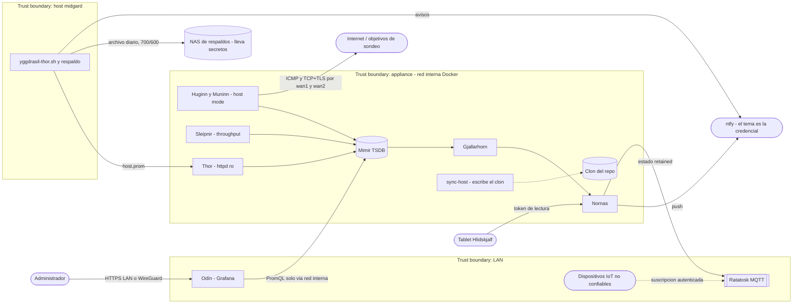
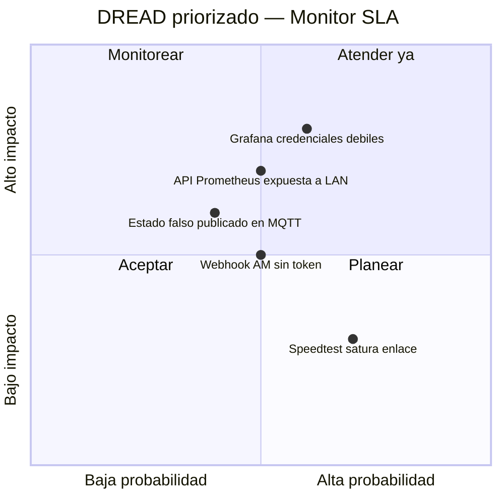

# Threat Model — Monitor SLA de Internet

* **Estado:** approved
* **Fecha:** 2026-09-01
* **Decisores:** Jeremi
* **Fase AI-DLC:** 02-design
* **Versión:** 0.2.2 (revisiones 2026-10-19 y 2026-10-21, al pie)
* **Gate:** 1
* **Alcance:** Servicio Monitor SLA (sondas, TSDB, dashboards, puente MQTT), tablero de pared, métricas del host (Thor), despliegue continuo, respaldo y avisos
* **Metodología:** STRIDE + DREAD
* **Clasificación de datos (ref):** `docs/00-project/data-classification.md`

## Diagrama de flujo de datos (DFD)

*Eje comportamiento (DFD) · fase 02 · insumo del STRIDE.*

## Análisis STRIDE
| Componente | Spoofing | Tampering | Repudiation | Info Disclosure | DoS | Elevation |
|---|---|---|---|---|---|---|
| Grafana | Login por defecto débil → credenciales fuertes, sin anónimo | Edición de dashboards → roles | Logs de acceso activos | Métricas de presencia → solo LAN/WG | Rate limit implícito LAN | Sin plugins no firmados |
| Prometheus | — | Escritura/borrado TSDB → puerto no publicado | — | API abierta → solo red interna | Cardinalidad de labels acotada | Contenedor no-root |
| Blackbox (host) | Objetivos suplantados (DNS) → objetivos por IP + HTTPS | Config de módulos → volumen ro | — | — | Frecuencia de sondas acotada | `nobody` con `cap_drop: [ALL]`; ICMP por `ping_group_range` (v0.4.8) |
| Alertmanager → Node-RED | Webhook falso → token Bearer en cabecera Authorization, solo por la red interna de Compose | Payload manipulado → validación en flujo | — | — | Agrupación/inhibición configuradas | — |
| MQTT (Ratatosk, 1883 en la IP LAN) | Cliente anónimo → `allow_anonymous false`, credencial por cliente (`nornas`, `iot`) | Publicar estado falso → ACL: solo `nornas` escribe `midgard/#` (ADR-0006) | — | Suscripción abierta → ACL de lectura por usuario | Flood → `max_connections`, `max_queued_messages`, `message_size_limit` | Contenedor con rootfs de solo lectura |
| Node-RED (Nornas, editor 1880 en la IP LAN) | Editor sin login → `adminAuth` obligatorio con bcrypt | Flujos alterados → solo administradores autenticados | Auditoría del runtime activada | — | LAN/WireGuard únicamente | Sin `require` dinámico en functions; paleta instalable solo por admin (riesgo aceptado) |

## Amenazas priorizadas (DREAD)

| ID | Amenaza | D | R | E | A | D | Score | Control / ADR |
|---|---|---|---|---|---|---|---|---|
| T1 | Acceso a Grafana con credenciales por defecto | 7 | 9 | 8 | 5 | 7 | 7.2 | Password fuerte + sin anónimo (RS01) |
| T2 | API de Prometheus alcanzable desde la LAN/IoT | 6 | 8 | 7 | 5 | 6 | 6.4 | No publicar 9090; solo red interna (ADR-0003) |
| T3 | Dispositivo IoT publica estado falso en `midgard/wan/#` | 6 | 6 | 5 | 4 | 5 | 5.2 | ACL de Ratatosk por usuario/tópico, control propio desde ADR-0006 |
| T4 | Webhook Alertmanager→Node-RED falsificado | 5 | 6 | 5 | 4 | 5 | 5.0 | Token Bearer en cabecera + validación en flujo (implementado en Gate 2; el token no queda en logs de acceso) |
| T5 | Sonda de throughput degrada el servicio del hogar | 4 | 8 | 6 | 6 | 3 | 5.4 | Cada WAN cada 6 h (Sleipnir mide cada 3 h alternando), ~70 s por medición; Hlidskjalf y las reglas descuentan la pérdida que provoca. El «horario valle» previsto en Gate 1 no se implementó |
| T6 | Lectura del estado de midgard por `/hlidskjalf/resumen` desde la LAN (patrones de presencia) | 3 | 7 | 5 | 4 | 5 | 4.8 | Token de solo lectura propio (`HLIDSKJALF_TOKEN`, ≥ 32 caracteres, comparación en tiempo constante); sin token, 503; solo LAN, sin puerto nuevo; la página escapa todo texto y lleva CSP por hash (ADR-0007) |

| T7 | `sync-host` escribe en el clon del repo (bind mount `..:/repo`): un contenedor comprometido podría alterar el código que se despliega | 8 | 3 | 4 | 3 | 4 | 4.4 | Contenedor de un solo uso como el usuario `deploy` (no root), rootfs de solo lectura y `no-new-privileges`; hace checkout del commit `IMAGE_TAG`, que fija el receptor a partir del webhook firmado (ADR-0005). Corre en host-mode (necesita ver las WAN para el render), así que tiene red. Aceptado (HITL 2026-10-19) |
| T8 | Archivo de respaldo en el NAS: lleva el `.env` y la configuración renderizada (secretos) | 9 | 3 | 4 | 3 | 4 | 4.6 | Directorio 700 y ficheros 600; el export `respaldos` solo admite a midgard; retención 14 días. Aceptado (HITL 2026-10-19) |
| T9 | El tema de ntfy es la credencial: quien lo conozca lee los avisos (incluidas caídas y respaldos) | 4 | 6 | 7 | 3 | 4 | 4.8 | Tema aleatorio en `/etc/yggdrasil-aviso.env` y en `.env` (600), fuera del repo; un solo fichero que rotar. Aceptado (HITL 2026-10-19) |
| T10 | Datos del host (Thor): número de serie de los discos e inventario de servicios | 2 | 4 | 4 | 3 | 3 | 3.2 | La salida de `smartctl` se guarda en `/var/cache/yggdrasil-thor` (0700), fuera de lo que se sirve; el contenedor monta el directorio en solo lectura y no publica puerto. Aceptado (HITL 2026-10-19) |
| T11 | Credenciales de PIA en midgard (`/etc/yggdrasil-pia.env`): quien las lea usa la cuenta de PIA de Jeremi | 5 | 3 | 3 | 2 | 3 | 3.2 | Fichero de root 600 que escribe Jeremi; `pia-tunel.sh` lo lee sin `source` y pasa usuario, contraseña y token a curl por descriptor, nunca como argumento; token y clave privada solo en memoria; `prueba-pia.sh` comprueba que no aparecen en la línea de órdenes ni en el journal (ADR-0009). Aceptado (HITL 2026-10-21) |
| T12 | PIA ve los metadatos de todo el tráfico del PC (destinos, volumen, horario) | 4 | 9 | 2 | 1 | 3 | 3.8 | Riesgo **aceptado** por Jeremi (HITL 2026-10-21, ADR-0009). El contenido sigue cifrado por cada aplicación (TLS). Puntuación aceptada (HITL 2026-10-21) |

## Detección en operación (T7-T10)

Las puntuaciones de T7-T10 son una estimación de diseño: se revisarán con lo que mida el monitoreo
durante el uso. Cada amenaza tiene una señal que Thor publicará y una alerta. Estado: **por
implementar** (PR de código siguiente).

| Amenaza | Qué se vigila | Métrica prevista (Thor) | Alerta prevista |
|---|---|---|---|
| T7 | El clon de `/srv/apps/yggdrasil` no tiene cambios fuera de lo ignorado (`git status --porcelain` vacío) y su `HEAD` es el commit que el receptor dice haber desplegado (`current_tag`) | `yggdrasil_clon_coherente` (1/0) | `ClonAlterado` (critical, 10 min: tolera la ventana de un despliegue) |
| T8 | El directorio de respaldos del NAS sigue en 700 y cada archivo en 600 | `yggdrasil_respaldo_permisos_ok{respaldo}` (1/0) | `RespaldoPermisosAbiertos` (critical) |
| T9 | Nadie puede saber desde midgard quién lee un tema de ntfy: no hay detección técnica. Se mide la antigüedad del tema para rotarlo según una política | `yggdrasil_aviso_tema_edad_dias` | Ninguna; la rotación es manual. Revisar si el tema se ha compartido |
| T10 | La caché de `smartctl` sigue en 0700, y `host.prom`, que se sirve, no contiene números de serie | `yggdrasil_thor_cache_permisos_ok` (1/0) | `ThorCacheExpuesta` (warning) |

Criterio de revisión: con 30 días de estas series, cada amenaza conserva su puntuación o se
reevalúa. Algunos ejemplos: un `ClonAlterado` que salte fuera de un despliegue sube la
reproducibilidad de T7; unos permisos que se pierdan en el NAS (si el NAS fuerza el modo, por
ejemplo) suben la explotabilidad de T8.

## Controles y trazabilidad
- T1 → RS01 (PRD) · ASVS V2 · verificación por inspección en Gate 3.
- T2, T4 → ADR-0003 (topología de red de contenedores) · ASVS V13.
- T3 → `deploy/mosquitto/acl` (Ratatosk, ADR-0006) — control propio de la plataforma.
- T5 → RF02 y regla de scheduler — verificación por test de carga en Gate 3.
- T6 → ADR-0007 · `deploy/nornas/tests/hlidskjalf.test.mjs` (401/503, escape de HTML, CSP). T2 se mantiene: el tablero consulta Mimir y Gjallarhorn desde Nornas, por la red interna, sin publicarlos.
- T7 → ADR-0005 · `deploy/docker-compose.cd.yml`. T8 → `deploy/cd/README.md` (respaldo al NAS). T9 →
  `deploy/cd/README.md` (avisos por ntfy) y `data-classification.md`. T10 → `deploy/cd/README.md` (Thor).
- T11, T12 → ADR-0009 · `deploy/host/pia-tunel.sh` · `deploy/host/tests/prueba-pia.sh` · `data-classification.md`.

> **Revisión 2026-10-19 — coherencia con la v0.5.13** (auditoría documental).
> - El DFD y el alcance suman Thor, el respaldo al NAS, ntfy, la tablet y la tarea `sync-host`.
> - Se proponen T7 a T10, con sus puntuaciones DREAD pendientes de que Jeremi las confirme. T7 es
>   la amenaza que ADR-0005 llamaba «T6».
> - Blackbox ya no lleva `NET_RAW` (v0.4.8).
> - Ratatosk ya no tiene el cliente `frigate` (0.5.3).
> - T5 deja de prometer un horario valle que nunca se implementó.

> **Revisión 2026-10-19 — DREAD de T7-T10 aceptado.** Jeremi acepta las puntuaciones. En T7 y T8 se
> corrigen las columnas de daño y reproducibilidad, que estaban intercambiadas (la media no
> cambia): alterar el código que se despliega y filtrar todos los secretos son daños altos (8 y 9),
> y los dos exigen un compromiso previo (reproducibilidad 3). Las puntuaciones se revisarán con las
> señales de «Detección en operación» tras 30 días de datos.

> **Revisión 2026-10-21 — túnel PIA (ADR-0009).** Se añaden T11, las credenciales de PIA en midgard, y T12,
> PIA como observador del tráfico del PC. Jeremi acepta el riesgo de T12. Las dos puntuaciones DREAD son
> propuestas y quedan pendientes de su confirmación.

> **Revisión 2026-10-21 (2) — DREAD de T11 y T12 aceptado.** Jeremi acepta las puntuaciones propuestas:
> T11 3,2 y T12 3,8.
