# Historial de implementación — Yggdrasil

* **Estado:** review
* **Fecha:** 2026-10-19
* **Decisores:** Jeremi
* **Fase AI-DLC:** 03-implementation
* **Versión:** 0.3.0
* **Gate:** 2
* **Rama principal:** main
* **Estrategia de branching:** GitFlow

Documento generado por `scripts/generar-historial.py` a partir de `git log`; no editar a mano.
Regenerar tras cada merge o tag. Los tags SemVer enlazan con las versiones del `CHANGELOG.md`.

## Vista de releases (`main`, primer padre)
`main` solo recibe merges de `release/*` (y `hotfix/*`) por PR con merge commit; cada merge lleva su tag.

```mermaid
gitGraph
    commit id: "d6481c7"
    branch release/0.1.0
    checkout release/0.1.0
    commit id: "075c41f"
    commit id: "43bfd9d"
    commit id: "76260b2"
    commit id: "578adc6"
    commit id: "bf29579"
    checkout main
    merge release/0.1.0 tag: "v0.1.0"
    branch release/0.2.0
    checkout release/0.2.0
    commit id: "dfbb279"
    commit id: "d57d604"
    commit id: "648454b"
    commit id: "007f76b"
    commit id: "a3235bc"
    commit id: "73d38d1"
    commit id: "91862b1"
    commit id: "8b7e57d"
    commit id: "02bb50d"
    checkout main
    merge release/0.2.0 tag: "v0.2.0"
    branch release/0.3.0
    checkout release/0.3.0
    commit id: "1b84b29"
    commit id: "2501ca1"
    commit id: "8beb675"
    commit id: "4fd9fac"
    commit id: "89059c7"
    commit id: "5f14eb6"
    commit id: "a1b81cc"
    commit id: "7436d34"
    commit id: "eff7242"
    commit id: "d375028"
    commit id: "0fa3f90"
    checkout main
    merge release/0.3.0 tag: "v0.3.0"
    branch release/0.4.0
    checkout release/0.4.0
    commit id: "8360c94"
    commit id: "d97b3fd"
    commit id: "1544e6d"
    commit id: "48dc03b"
    commit id: "2d3b928"
    commit id: "8d2073a"
    commit id: "8a0cce7"
    commit id: "a20481a"
    commit id: "d0f765e"
    commit id: "d8e728a"
    commit id: "c9e9412"
    commit id: "023e0da"
    commit id: "c66b21d"
    commit id: "02a0458"
    commit id: "c6efac2"
    commit id: "e1cd9c8"
    checkout main
    merge release/0.4.0 tag: "v0.4.0"
    branch hotfix/0.4.1
    checkout hotfix/0.4.1
    commit id: "e736cde"
    checkout main
    merge hotfix/0.4.1 tag: "v0.4.1"
    branch hotfix/0.4.2
    checkout hotfix/0.4.2
    commit id: "5eac749"
    checkout main
    merge hotfix/0.4.2 tag: "v0.4.2"
    branch release/0.4.3
    checkout release/0.4.3
    commit id: "e63e877"
    commit id: "c9b3d70"
    commit id: "adc6a33"
    commit id: "b2e9864"
    commit id: "43d1bb3"
    commit id: "f74988b"
    commit id: "4c58485"
    commit id: "8c4d9de"
    commit id: "fe2a427"
    commit id: "827a561"
    commit id: "0847938"
    commit id: "7aced20"
    commit id: "efc4629"
    commit id: "c9af132"
    checkout main
    merge release/0.4.3 tag: "v0.4.3"
    branch hotfix/0.4.4
    checkout hotfix/0.4.4
    commit id: "71a8f5e"
    checkout main
    merge hotfix/0.4.4 tag: "v0.4.4"
    branch hotfix/0.4.5
    checkout hotfix/0.4.5
    commit id: "2d30312"
    checkout main
    merge hotfix/0.4.5 tag: "v0.4.5"
    branch hotfix/0.4.6
    checkout hotfix/0.4.6
    commit id: "1e1617f"
    checkout main
    merge hotfix/0.4.6 tag: "v0.4.6"
    branch hotfix/0.4.7
    checkout hotfix/0.4.7
    commit id: "9694d60"
    checkout main
    merge hotfix/0.4.7 tag: "v0.4.7"
    branch hotfix/0.4.8
    checkout hotfix/0.4.8
    commit id: "4afb540"
    checkout main
    merge hotfix/0.4.8 tag: "v0.4.8"
    branch hotfix/0.4.9
    checkout hotfix/0.4.9
    commit id: "ea298e0"
    checkout main
    merge hotfix/0.4.9 tag: "v0.4.9"
    branch release/0.5.0
    checkout release/0.5.0
    commit id: "80a148a"
    commit id: "c47d6a8"
    commit id: "0abc9a1"
    commit id: "98474c9"
    commit id: "de64785"
    commit id: "216a1fe"
    commit id: "af94a95"
    commit id: "cbaadfb"
    commit id: "4bc3064"
    commit id: "4a1f321"
    commit id: "8a2379a"
    commit id: "6f42b07"
    commit id: "2704cb1"
    commit id: "a3c2825"
    commit id: "da99991"
    commit id: "150e17c"
    commit id: "f97cde6"
    commit id: "113553a"
    commit id: "fa36ce9"
    commit id: "f539c8d"
    checkout main
    merge release/0.5.0 tag: "v0.5.0"
    branch hotfix/0.5.1
    checkout hotfix/0.5.1
    commit id: "5ac9352"
    checkout main
    merge hotfix/0.5.1 tag: "v0.5.1"
    branch hotfix/0.5.2
    checkout hotfix/0.5.2
    commit id: "b57d2c0"
    checkout main
    merge hotfix/0.5.2 tag: "v0.5.2"
    branch hotfix/0.5.3
    checkout hotfix/0.5.3
    commit id: "e4c549b"
    checkout main
    merge hotfix/0.5.3 tag: "v0.5.3"
    branch release/0.5.4
    checkout release/0.5.4
    commit id: "fb0ea3b"
    commit id: "f11fae8"
    commit id: "aa69441"
    commit id: "b29dc67"
    commit id: "d90f394"
    commit id: "10843e2"
    commit id: "fa09af3"
    commit id: "d0bd486"
    commit id: "b2ca4c8"
    commit id: "d535e51"
    commit id: "f7382fb"
    commit id: "0edda8c"
    commit id: "8f73e3a"
    commit id: "9501145"
    commit id: "91d4bc4"
    commit id: "114a1fc"
    commit id: "5a8327a"
    checkout main
    merge release/0.5.4 tag: "v0.5.4"
    branch release/0.5.5
    checkout release/0.5.5
    commit id: "efbb1c6"
    commit id: "b5b4a29"
    commit id: "b7fdc0a"
    commit id: "f590810"
    commit id: "e8591c4"
    commit id: "3524288"
    checkout main
    merge release/0.5.5 tag: "v0.5.5"
    branch release/0.5.6
    checkout release/0.5.6
    commit id: "de474d0"
    commit id: "7fc177e"
    commit id: "8470ae7"
    commit id: "d9fbe01"
    commit id: "81bc079"
    commit id: "b54cb49"
    commit id: "afc1aa9"
    commit id: "3172f62"
    commit id: "a8d2948"
    commit id: "80a5c01"
    commit id: "3ff2cab"
    commit id: "a627d7d"
    commit id: "afd7565"
    commit id: "25ad7ed"
    commit id: "c43b351"
    commit id: "b6903b9"
    commit id: "6a77675"
    commit id: "92f2d49"
    commit id: "acdff11"
    checkout main
    merge release/0.5.6 tag: "v0.5.6"
    branch release/0.5.7
    checkout release/0.5.7
    commit id: "e4ca006"
    commit id: "7530aa8"
    commit id: "d481e8d"
    commit id: "f1bcd2f"
    checkout main
    merge release/0.5.7 tag: "v0.5.7"
    branch release/0.5.8
    checkout release/0.5.8
    commit id: "cdee041"
    commit id: "6b1b40e"
    commit id: "81428c0"
    commit id: "627690c"
    commit id: "9194586"
    commit id: "38ef1a4"
    checkout main
    merge release/0.5.8 tag: "v0.5.8"
    branch release/0.5.9
    checkout release/0.5.9
    commit id: "afeebb1"
    commit id: "a5932a6"
    commit id: "bca6302"
    commit id: "dd6c381"
    commit id: "83c289a"
    checkout main
    merge release/0.5.9 tag: "v0.5.9"
    branch release/0.5.10
    checkout release/0.5.10
    commit id: "59fa490"
    commit id: "841680d"
    commit id: "0369024"
    commit id: "316c7d0"
    checkout main
    merge release/0.5.10 tag: "v0.5.10"
    branch release/0.5.11
    checkout release/0.5.11
    commit id: "735f2d1"
    commit id: "c189c0b"
    commit id: "4283187"
    commit id: "b6808ba"
    commit id: "fc5593f"
    commit id: "483cec8"
    checkout main
    merge release/0.5.11 tag: "v0.5.11"
    branch release/0.5.12
    checkout release/0.5.12
    commit id: "16e5ab8"
    commit id: "8185ee6"
    commit id: "a2dc6aa"
    commit id: "d52010b"
    commit id: "d38adc4"
    commit id: "d43a823"
    checkout main
    merge release/0.5.12 tag: "v0.5.12"
    branch release/0.5.13
    checkout release/0.5.13
    commit id: "880de1d"
    commit id: "d64788d"
    commit id: "5b1ea9a"
    commit id: "0fa3b9c"
    commit id: "5ef5795"
    commit id: "16b6929"
    commit id: "c90d4d1"
    commit id: "fa589e7"
    checkout main
    merge release/0.5.13 tag: "v0.5.13"
```

*Eje trazabilidad · fase 03 · evidencia Gate 2.*

## Vista de integración (`develop`)
Features por PR; los bloques `backmerge-*` son los merges de `main` a `develop` tras cada release.

```mermaid
%%{init: { 'gitGraph': { 'mainBranchName': 'develop' } } }%%
gitGraph
    commit id: "d6481c7"
    branch feature/licencia-agpl-y-percentiles-latencia
    checkout feature/licencia-agpl-y-percentiles-latencia
    commit id: "075c41f"
    commit id: "43bfd9d"
    checkout develop
    merge feature/licencia-agpl-y-percentiles-latencia
    branch feature/umbrales-slo-gate-0
    checkout feature/umbrales-slo-gate-0
    commit id: "578adc6"
    checkout develop
    merge feature/umbrales-slo-gate-0
    branch backmerge-v0.1.0
    checkout backmerge-v0.1.0
    commit id: "bf29579"
    commit id: "5a160b8"
    checkout develop
    merge backmerge-v0.1.0
    branch feature/hallazgos-revision-inicial
    checkout feature/hallazgos-revision-inicial
    commit id: "648454b"
    commit id: "007f76b"
    commit id: "a3235bc"
    checkout develop
    merge feature/hallazgos-revision-inicial
    branch feature/acepta-adr-0001-0003-frontera-fenrir
    checkout feature/acepta-adr-0001-0003-frontera-fenrir
    commit id: "91862b1"
    checkout develop
    merge feature/acepta-adr-0001-0003-frontera-fenrir
    branch backmerge-v0.2.0
    checkout backmerge-v0.2.0
    commit id: "02bb50d"
    commit id: "9c62856"
    checkout develop
    merge backmerge-v0.2.0
    branch feature/gate-2-compose-configs
    checkout feature/gate-2-compose-configs
    commit id: "2501ca1"
    commit id: "8beb675"
    commit id: "4fd9fac"
    commit id: "89059c7"
    checkout develop
    merge feature/gate-2-compose-configs
    branch feature/gate-2-docs-y-cves
    checkout feature/gate-2-docs-y-cves
    commit id: "a1b81cc"
    commit id: "7436d34"
    commit id: "eff7242"
    checkout develop
    merge feature/gate-2-docs-y-cves
    branch feature/cd-despliegue-continuo
    checkout feature/cd-despliegue-continuo
    commit id: "8360c94"
    checkout develop
    merge feature/cd-despliegue-continuo
    branch backmerge-v0.3.0
    checkout backmerge-v0.3.0
    commit id: "0fa3f90"
    commit id: "58fe37a"
    checkout develop
    merge backmerge-v0.3.0
    branch docs/changelog-cd-historial
    checkout docs/changelog-cd-historial
    commit id: "48dc03b"
    commit id: "2d3b928"
    checkout develop
    merge docs/changelog-cd-historial
    branch docs/nftables-regla-real
    checkout docs/nftables-regla-real
    commit id: "8a0cce7"
    checkout develop
    merge docs/nftables-regla-real
    branch fix/bootstrap-branch
    checkout fix/bootstrap-branch
    commit id: "d0f765e"
    checkout develop
    merge fix/bootstrap-branch
    branch feature/ratatosk-nornas-plataforma
    checkout feature/ratatosk-nornas-plataforma
    commit id: "c9e9412"
    commit id: "023e0da"
    checkout develop
    merge feature/ratatosk-nornas-plataforma
    branch fix/render-wan-caida
    checkout fix/render-wan-caida
    commit id: "02a0458"
    checkout develop
    merge fix/render-wan-caida
    branch backmerge-v0.4.0
    checkout backmerge-v0.4.0
    commit id: "e1cd9c8"
    commit id: "20cba13"
    checkout develop
    merge backmerge-v0.4.0
    branch docs/ghcr-paquetes-publicos
    checkout docs/ghcr-paquetes-publicos
    commit id: "c9b3d70"
    checkout develop
    merge docs/ghcr-paquetes-publicos
    branch docs/ta01-health-timeout
    checkout docs/ta01-health-timeout
    commit id: "b2e9864"
    commit id: "43d1bb3"
    checkout develop
    merge docs/ta01-health-timeout
    branch backmerge-v0.4.1
    checkout backmerge-v0.4.1
    commit id: "e736cde"
    commit id: "ba72fdc"
    checkout develop
    merge backmerge-v0.4.1
    branch backmerge-v0.4.2
    checkout backmerge-v0.4.2
    commit id: "5eac749"
    commit id: "4b8effd"
    checkout develop
    merge backmerge-v0.4.2
    branch feature/cd-redespliegue-compose
    checkout feature/cd-redespliegue-compose
    commit id: "fe2a427"
    checkout develop
    merge feature/cd-redespliegue-compose
    branch feature/sleipnir-ookla
    checkout feature/sleipnir-ookla
    commit id: "0847938"
    commit id: "7aced20"
    checkout develop
    merge feature/sleipnir-ookla
    branch backmerge-v0.4.3
    checkout backmerge-v0.4.3
    commit id: "c9af132"
    commit id: "83ed588"
    checkout develop
    merge backmerge-v0.4.3
    branch backmerge-v0.4.4
    checkout backmerge-v0.4.4
    commit id: "71a8f5e"
    commit id: "4f0c325"
    checkout develop
    merge backmerge-v0.4.4
    branch backmerge-v0.4.5
    checkout backmerge-v0.4.5
    commit id: "2d30312"
    commit id: "5de612e"
    checkout develop
    merge backmerge-v0.4.5
    branch feature/ta-07-cierre
    checkout feature/ta-07-cierre
    commit id: "98474c9"
    checkout develop
    merge feature/ta-07-cierre
    branch backmerge-v0.4.6
    checkout backmerge-v0.4.6
    commit id: "1e1617f"
    commit id: "2dc734a"
    checkout develop
    merge backmerge-v0.4.6
    branch feature/gate-3-evidencia
    checkout feature/gate-3-evidencia
    commit id: "af94a95"
    checkout develop
    merge feature/gate-3-evidencia
    branch backmerge-v0.4.7
    checkout backmerge-v0.4.7
    commit id: "9694d60"
    commit id: "797a356"
    checkout develop
    merge backmerge-v0.4.7
    branch backmerge-v0.4.8
    checkout backmerge-v0.4.8
    commit id: "4afb540"
    commit id: "3d0e5e1"
    checkout develop
    merge backmerge-v0.4.8
    branch feature/gate-3-seguridad
    checkout feature/gate-3-seguridad
    commit id: "8a2379a"
    commit id: "6f42b07"
    checkout develop
    merge feature/gate-3-seguridad
    branch feature/ta-13-evidencia
    checkout feature/ta-13-evidencia
    commit id: "a3c2825"
    checkout develop
    merge feature/ta-13-evidencia
    branch backmerge-v0.4.9
    checkout backmerge-v0.4.9
    commit id: "ea298e0"
    commit id: "9a1efbe"
    checkout develop
    merge backmerge-v0.4.9
    branch feature/ta-13-superado
    checkout feature/ta-13-superado
    commit id: "f97cde6"
    checkout develop
    merge feature/ta-13-superado
    branch backmerge-v0.5.2
    checkout backmerge-v0.5.2
    commit id: "fa36ce9"
    commit id: "f539c8d"
    commit id: "117278e"
    commit id: "5ac9352"
    commit id: "5852d65"
    commit id: "b57d2c0"
    commit id: "47221d5"
    checkout develop
    merge backmerge-v0.5.2
    branch feature/fenrir-dashboard
    checkout feature/fenrir-dashboard
    commit id: "f11fae8"
    checkout develop
    merge feature/fenrir-dashboard
    branch feature/retirar-dashboard-fenrir
    checkout feature/retirar-dashboard-fenrir
    commit id: "b29dc67"
    checkout develop
    merge feature/retirar-dashboard-fenrir
    branch backmerge-v0.5.3
    checkout backmerge-v0.5.3
    commit id: "e4c549b"
    commit id: "5dd4b25"
    checkout develop
    merge backmerge-v0.5.3
    branch feature/slo-throughput-por-direccion
    checkout feature/slo-throughput-por-direccion
    commit id: "fa09af3"
    commit id: "d0bd486"
    checkout develop
    merge feature/slo-throughput-por-direccion
    branch feature/guardian-ruta-main
    checkout feature/guardian-ruta-main
    commit id: "f7382fb"
    commit id: "0edda8c"
    commit id: "8f73e3a"
    checkout develop
    merge feature/guardian-ruta-main
    branch feature/sonda-ruta-hogar
    checkout feature/sonda-ruta-hogar
    commit id: "d535e51"
    commit id: "91d4bc4"
    checkout develop
    merge feature/sonda-ruta-hogar
    branch backmerge-v0.5.4
    checkout backmerge-v0.5.4
    commit id: "5a8327a"
    commit id: "e5343d6"
    checkout develop
    merge backmerge-v0.5.4
    branch fix/retirar-anclaje-wan2
    checkout fix/retirar-anclaje-wan2
    commit id: "b5b4a29"
    commit id: "b7fdc0a"
    commit id: "f590810"
    checkout develop
    merge fix/retirar-anclaje-wan2
    branch backmerge-v0.5.5
    checkout backmerge-v0.5.5
    commit id: "3524288"
    commit id: "b6afcb3"
    checkout develop
    merge backmerge-v0.5.5
    branch docs/reserva-bragi
    checkout docs/reserva-bragi
    commit id: "7fc177e"
    checkout develop
    merge docs/reserva-bragi
    branch feature/bragi-observabilidad
    checkout feature/bragi-observabilidad
    commit id: "d9fbe01"
    checkout develop
    merge feature/bragi-observabilidad
    branch feature/respaldo-nocturno
    checkout feature/respaldo-nocturno
    commit id: "b54cb49"
    checkout develop
    merge feature/respaldo-nocturno
    branch feature/aviso-respaldo
    checkout feature/aviso-respaldo
    commit id: "3172f62"
    checkout develop
    merge feature/aviso-respaldo
    branch feature/nornas-ntfy
    checkout feature/nornas-ntfy
    commit id: "a8d2948"
    commit id: "3ff2cab"
    checkout develop
    merge feature/nornas-ntfy
    branch fix/guardian-sandbox
    checkout fix/guardian-sandbox
    commit id: "afd7565"
    checkout develop
    merge fix/guardian-sandbox
    branch feature/vigia-servicios
    checkout feature/vigia-servicios
    commit id: "c43b351"
    checkout develop
    merge feature/vigia-servicios
    branch feature/balanceador-quorum
    checkout feature/balanceador-quorum
    commit id: "6a77675"
    checkout develop
    merge feature/balanceador-quorum
    branch backmerge-v0.5.6
    checkout backmerge-v0.5.6
    commit id: "acdff11"
    commit id: "3c06e55"
    checkout develop
    merge backmerge-v0.5.6
    branch fix/montar-directorios
    checkout fix/montar-directorios
    commit id: "7530aa8"
    checkout develop
    merge fix/montar-directorios
    branch backmerge-v0.5.7
    checkout backmerge-v0.5.7
    commit id: "f1bcd2f"
    commit id: "d183218"
    checkout develop
    merge backmerge-v0.5.7
    branch fix/reglas-intervalo
    checkout fix/reglas-intervalo
    commit id: "6b1b40e"
    checkout develop
    merge fix/reglas-intervalo
    branch feature/metricas-host
    checkout feature/metricas-host
    commit id: "627690c"
    checkout develop
    merge feature/metricas-host
    branch backmerge-v0.5.8
    checkout backmerge-v0.5.8
    commit id: "38ef1a4"
    commit id: "f486288"
    checkout develop
    merge backmerge-v0.5.8
    branch feature/hlidskjalf
    checkout feature/hlidskjalf
    commit id: "a5932a6"
    commit id: "bca6302"
    checkout develop
    merge feature/hlidskjalf
    branch backmerge-v0.5.9
    checkout backmerge-v0.5.9
    commit id: "83c289a"
    commit id: "72492aa"
    checkout develop
    merge backmerge-v0.5.9
    branch feature/perdida-wan-robusta
    checkout feature/perdida-wan-robusta
    commit id: "841680d"
    checkout develop
    merge feature/perdida-wan-robusta
    branch backmerge-v0.5.10
    checkout backmerge-v0.5.10
    commit id: "316c7d0"
    commit id: "58cbe26"
    checkout develop
    merge backmerge-v0.5.10
    branch fix/thor-nombres-temporales
    checkout fix/thor-nombres-temporales
    commit id: "c189c0b"
    checkout develop
    merge fix/thor-nombres-temporales
    branch feature/sleipnir-modos-alternativos
    checkout feature/sleipnir-modos-alternativos
    commit id: "b6808ba"
    checkout develop
    merge feature/sleipnir-modos-alternativos
    branch backmerge-v0.5.11
    checkout backmerge-v0.5.11
    commit id: "483cec8"
    commit id: "383a3bb"
    checkout develop
    merge backmerge-v0.5.11
    branch fix/build-sin-reconstruir
    checkout fix/build-sin-reconstruir
    commit id: "8185ee6"
    checkout develop
    merge fix/build-sin-reconstruir
    branch feature/ssd-en-thor-y-hlidskjalf
    checkout feature/ssd-en-thor-y-hlidskjalf
    commit id: "d52010b"
    checkout develop
    merge feature/ssd-en-thor-y-hlidskjalf
    branch backmerge-v0.5.12
    checkout backmerge-v0.5.12
    commit id: "d43a823"
    commit id: "e728c9c"
    checkout develop
    merge backmerge-v0.5.12
    branch feature/respaldos-hermod-andvari
    checkout feature/respaldos-hermod-andvari
    commit id: "d64788d"
    checkout develop
    merge feature/respaldos-hermod-andvari
    branch fix/hlidskjalf-alertas-visibles
    checkout fix/hlidskjalf-alertas-visibles
    commit id: "0fa3b9c"
    checkout develop
    merge fix/hlidskjalf-alertas-visibles
    branch feature/hlidskjalf-sin-perdida
    checkout feature/hlidskjalf-sin-perdida
    commit id: "16b6929"
    checkout develop
    merge feature/hlidskjalf-sin-perdida
    branch backmerge-v0.5.13
    checkout backmerge-v0.5.13
    commit id: "fa589e7"
    commit id: "0db75a1"
    checkout develop
    merge backmerge-v0.5.13
    branch feature/hlidskjalf-vista-previa
    checkout feature/hlidskjalf-vista-previa
    commit id: "1376fa8"
    checkout develop
    merge feature/hlidskjalf-vista-previa
```

*Eje trazabilidad · fase 03 · evidencia Gate 2.*

## Trazabilidad tag ↔ versión ↔ decisión
| Tag | Versión CHANGELOG | ADR / decisión | Nota |
|---|---|---|---|
| v0.1.0 | 0.1.0 (Gate 0) | Umbrales SLO y hosts de sondeo confirmados; licencia AGPL-3.0 | release/0.1.0 desde la punta del PR #2 |
| v0.2.0 | 0.2.0 (Gate 1) | ADR-0001, ADR-0003 aceptados; ADR-0004 frontera con Fenrir | release/0.2.0 desde develop |
| v0.3.0 | — | — | — |
| v0.4.0 | — | — | — |
| v0.4.1 | — | — | — |
| v0.4.2 | — | — | — |
| v0.4.3 | — | — | — |
| v0.4.4 | — | — | — |
| v0.4.5 | — | — | — |
| v0.4.6 | — | — | — |
| v0.4.7 | — | — | — |
| v0.4.8 | — | — | — |
| v0.4.9 | — | — | — |
| v0.5.0 | — | — | — |
| v0.5.1 | — | — | — |
| v0.5.2 | — | — | — |
| v0.5.3 | — | — | — |
| v0.5.4 | — | — | — |
| v0.5.5 | — | — | — |
| v0.5.6 | — | — | — |
| v0.5.7 | — | — | — |
| v0.5.8 | — | — | — |
| v0.5.9 | — | — | — |
| v0.5.10 | — | — | — |
| v0.5.11 | — | — | — |
| v0.5.12 | — | — | — |
| v0.5.13 | — | — | — |

## Bitácora de cambios (fiel al repo)
| Commit | Tipo | Tags | Autor | Fecha | Mensaje |
|---|---|---|---|---|---|
| `58941d1` | merge | — | Jeremi J. Alcalá M. | 2026-10-19 | Merge pull request #77 from higerotech/feature/hlidskjalf-vista-previa |
| `1376fa8` | commit | — | Jeremi Alcala | 2026-10-19 | feat(hlidskjalf): vista previa del tablero en la tablet real |
| `600eac4` | merge | — | Jeremi Alcala | 2026-10-19 | Merge main (v0.5.13) en develop |
| `0db75a1` | merge | v0.5.13 | Jeremi J. Alcalá M. | 2026-10-19 | Merge pull request #76 from higerotech/release/0.5.13 |
| `fa589e7` | commit | — | Jeremi Alcala | 2026-10-19 | chore(release): 0.5.13 |
| `c90d4d1` | merge | — | Jeremi J. Alcalá M. | 2026-10-19 | Merge pull request #75 from higerotech/feature/hlidskjalf-sin-perdida |
| `16b6929` | commit | — | Jeremi Alcala | 2026-10-19 | feat(hlidskjalf): ningun dato se pierde sin avisar en la tablet |
| `5ef5795` | merge | — | Jeremi J. Alcalá M. | 2026-10-19 | Merge pull request #74 from higerotech/fix/hlidskjalf-alertas-visibles |
| `0fa3b9c` | commit | — | Jeremi Alcala | 2026-10-19 | fix(hlidskjalf): las alertas activas se ven siempre |
| `5b1ea9a` | merge | — | Jeremi J. Alcalá M. | 2026-10-19 | Merge pull request #73 from higerotech/feature/respaldos-hermod-andvari |
| `d64788d` | commit | — | Jeremi Alcala | 2026-10-19 | feat(hlidskjalf): nombrar los respaldos de Hermod y Andvari |
| `880de1d` | merge | — | Jeremi Alcala | 2026-10-19 | Merge main (v0.5.12) en develop |
| `e728c9c` | merge | v0.5.12 | Jeremi J. Alcalá M. | 2026-10-19 | Merge pull request #72 from higerotech/release/0.5.12 |
| `d43a823` | commit | — | Jeremi Alcala | 2026-10-19 | chore(release): 0.5.12 |
| `d38adc4` | merge | — | Jeremi J. Alcalá M. | 2026-10-19 | Merge pull request #71 from higerotech/feature/ssd-en-thor-y-hlidskjalf |
| `d52010b` | commit | — | Jeremi Alcala | 2026-10-19 | feat(thor): vigilar el SSD de datos y el respaldo de Bifrost en Hlidskjalf |
| `a2dc6aa` | merge | — | Jeremi J. Alcalá M. | 2026-10-18 | Merge pull request #70 from higerotech/fix/build-sin-reconstruir |
| `8185ee6` | commit | — | Jeremi Alcala | 2026-10-18 | fix(ci): no reconstruir una imagen ya publicada para el commit |
| `16e5ab8` | merge | — | Jeremi Alcala | 2026-10-18 | Merge main (v0.5.11) en develop |
| `383a3bb` | merge | v0.5.11 | Jeremi J. Alcalá M. | 2026-10-18 | Merge pull request #69 from higerotech/release/0.5.11 |
| `483cec8` | commit | — | Jeremi Alcala | 2026-10-18 | chore(release): 0.5.11 |
| `fc5593f` | merge | — | Jeremi J. Alcalá M. | 2026-10-18 | Merge pull request #68 from higerotech/feature/sleipnir-modos-alternativos |
| `b6808ba` | commit | — | Jeremi Alcala | 2026-10-18 | fix(sleipnir): restaurar los modos speedtest e iperf3 |
| `4283187` | merge | — | Jeremi J. Alcalá M. | 2026-10-18 | Merge pull request #67 from higerotech/fix/thor-nombres-temporales |
| `c189c0b` | commit | — | Jeremi Alcala | 2026-10-17 | fix(thor): ignorar los contenedores que Compose renombra al recrear |
| `735f2d1` | merge | — | Jeremi Alcala | 2026-10-17 | Merge main (v0.5.10) en develop |
| `58cbe26` | merge | v0.5.10 | Jeremi J. Alcalá M. | 2026-10-17 | Merge pull request #66 from higerotech/release/0.5.10 |
| `316c7d0` | commit | — | Jeremi Alcala | 2026-10-17 | chore(release): 0.5.10 |
| `0369024` | merge | — | Jeremi J. Alcalá M. | 2026-10-16 | Merge pull request #65 from higerotech/feature/perdida-wan-robusta |
| `841680d` | commit | — | Jeremi Alcala | 2026-10-16 | feat(heimdall): perdida por mediana de tres objetivos y medicion de Sleipnir en la tablet |
| `59fa490` | merge | — | Jeremi Alcala | 2026-10-16 | Merge main (v0.5.9) en develop |
| `72492aa` | merge | v0.5.9 | Jeremi J. Alcalá M. | 2026-10-16 | Merge pull request #64 from higerotech/release/0.5.9 |
| `83c289a` | commit | — | Jeremi Alcala | 2026-10-16 | chore(release): 0.5.9 |
| `dd6c381` | merge | — | Jeremi J. Alcalá M. | 2026-10-16 | Merge pull request #63 from higerotech/feature/hlidskjalf |
| `bca6302` | commit | — | Jeremi Alcala | 2026-10-16 | test(hlidskjalf): margen de 2 s en las edades del resumen |
| `a5932a6` | commit | — | Jeremi Alcala | 2026-10-16 | feat(hlidskjalf): tablero de pared con el estado de midgard en una tablet kiosco |
| `afeebb1` | merge | — | Jeremi Alcala | 2026-10-16 | Merge main (v0.5.8) en develop |
| `f486288` | merge | v0.5.8 | Jeremi J. Alcalá M. | 2026-10-16 | Merge pull request #62 from higerotech/release/0.5.8 |
| `38ef1a4` | commit | — | Jeremi Alcala | 2026-10-16 | chore(release): 0.5.8 |
| `9194586` | merge | — | Jeremi J. Alcalá M. | 2026-10-16 | Merge pull request #61 from higerotech/feature/metricas-host |
| `627690c` | commit | — | Jeremi Alcala | 2026-10-16 | feat(thor): metricas del host y alertas de disco, NAS y discrepancia |
| `81428c0` | merge | — | Jeremi J. Alcalá M. | 2026-10-16 | Merge pull request #60 from higerotech/fix/reglas-intervalo |
| `6b1b40e` | commit | — | Jeremi Alcala | 2026-10-16 | fix(prometheus): reglas de 1 min para que sus series no salgan vacias |
| `cdee041` | merge | — | Jeremi Alcala | 2026-10-06 | Merge main (v0.5.7) en develop |
| `d183218` | merge | v0.5.7 | Jeremi J. Alcalá M. | 2026-10-06 | Merge pull request #59 from higerotech/release/0.5.7 |
| `f1bcd2f` | commit | — | Jeremi Alcala | 2026-10-06 | release: 0.5.7 (montar directorios de configuracion) |
| `d481e8d` | merge | — | Jeremi J. Alcalá M. | 2026-10-06 | Merge pull request #58 from higerotech/fix/montar-directorios |
| `7530aa8` | commit | — | Jeremi Alcala | 2026-10-06 | fix(compose): montar el directorio de blackbox y alertmanager, no el fichero |
| `e4ca006` | merge | — | Jeremi Alcala | 2026-10-06 | Merge main (v0.5.6) en develop |
| `3c06e55` | merge | v0.5.6 | Jeremi J. Alcalá M. | 2026-10-05 | Merge pull request #57 from higerotech/release/0.5.6 |
| `acdff11` | commit | — | Jeremi Alcala | 2026-10-05 | release: 0.5.6 (respaldo, avisos ntfy y salud de WAN por TCP) |
| `92f2d49` | merge | — | Jeremi Alcala | 2026-10-05 | Merge pull request #56 from higerotech/feature/balanceador-quorum |
| `6a77675` | commit | — | Jeremi Alcala | 2026-10-05 | feat(host): salud de cada WAN por mayoria de destinos TCP |
| `b6903b9` | merge | — | Jeremi J. Alcalá M. | 2026-10-05 | Merge pull request #55 from higerotech/feature/vigia-servicios |
| `c43b351` | commit | — | Jeremi Alcala | 2026-10-05 | feat(cd): vigia que avisa por ntfy si un servicio sale de linea |
| `25ad7ed` | merge | — | Jeremi J. Alcalá M. | 2026-10-05 | Merge pull request #54 from higerotech/fix/guardian-sandbox |
| `afd7565` | commit | — | Jeremi Alcala | 2026-10-05 | fix(host): el guardian no podia re-renderizar las sondas |
| `a627d7d` | merge | — | Jeremi J. Alcalá M. | 2026-10-05 | Merge pull request #53 from higerotech/feature/nornas-ntfy |
| `3ff2cab` | merge | — | Jeremi J. Alcalá M. | 2026-10-05 | Merge branch 'develop' into feature/nornas-ntfy |
| `80a5c01` | merge | — | Jeremi J. Alcalá M. | 2026-10-05 | Merge pull request #52 from higerotech/feature/aviso-respaldo |
| `a8d2948` | commit | — | Jeremi Alcala | 2026-10-05 | feat(nornas): publicar las alertas de Heimdall en ntfy |
| `3172f62` | commit | — | Jeremi Alcala | 2026-10-05 | feat(cd): avisos por ntfy del respaldo nocturno |
| `afc1aa9` | merge | — | Jeremi J. Alcalá M. | 2026-10-05 | Merge pull request #51 from higerotech/feature/respaldo-nocturno |
| `b54cb49` | commit | — | Jeremi Alcala | 2026-10-05 | feat(cd): respaldo nocturno de Yggdrasil al NAS |
| `56e7f6b` | commit | — | Jeremi J. Alcalá M. | 2026-09-18 | Revert "feat(prometheus): observabilidad de Bragi (job y reglas)" |
| `81bc079` | merge | — | Jeremi J. Alcalá M. | 2026-09-18 | Merge pull request #50 from higerotech/feature/bragi-observabilidad |
| `d9fbe01` | commit | — | Jeremi Alcala | 2026-09-18 | feat(prometheus): observabilidad de Bragi (job y reglas) |
| `8470ae7` | merge | — | Jeremi J. Alcalá M. | 2026-09-17 | Merge pull request #49 from higerotech/docs/reserva-bragi |
| `7fc177e` | commit | — | Jeremi Alcala | 2026-09-17 | docs: reserva Bragi para el servidor de medios Jellyfin |
| `de474d0` | merge | — | Jeremi Alcala | 2026-09-17 | Merge main (v0.5.5) en develop |
| `b6afcb3` | merge | v0.5.5 | Jeremi J. Alcalá M. | 2026-09-17 | Merge pull request #48 from higerotech/release/0.5.5 |
| `3524288` | commit | — | Jeremi Alcala | 2026-09-17 | release: 0.5.5 (reglas y sondas que se reconcilian solas) |
| `e8591c4` | merge | — | Jeremi J. Alcalá M. | 2026-09-17 | Merge pull request #47 from higerotech/fix/retirar-anclaje-wan2 |
| `f590810` | commit | — | Jeremi Alcala | 2026-09-17 | feat(router): el guardian reconcilia la IP de las sondas de Heimdall |
| `b7fdc0a` | commit | — | Jeremi Alcala | 2026-09-17 | fix(router): poda las reglas de origen huerfanas al renovar la IP |
| `b5b4a29` | commit | — | Jeremi Alcala | 2026-09-17 | fix(router): retira el anclaje muerto de 192.168.10.21 a wan2 |
| `efbb1c6` | merge | — | Jeremi Alcala | 2026-09-17 | Merge main (v0.5.4) en develop |
| `e5343d6` | merge | v0.5.4 | Jeremi J. Alcalá M. | 2026-09-17 | Merge pull request #46 from higerotech/release/0.5.4 |
| `5a8327a` | commit | — | Jeremi Alcala | 2026-09-17 | release: 0.5.4 (revision completa del appliance) |
| `114a1fc` | merge | — | Jeremi J. Alcalá M. | 2026-09-17 | Merge pull request #44 from higerotech/feature/sonda-ruta-hogar |
| `91d4bc4` | merge | — | Jeremi J. Alcalá M. | 2026-09-17 | Merge branch 'develop' into feature/sonda-ruta-hogar |
| `9501145` | merge | — | Jeremi J. Alcalá M. | 2026-09-17 | Merge pull request #45 from higerotech/feature/guardian-ruta-main |
| `8f73e3a` | commit | — | Jeremi Alcala | 2026-09-17 | ci: la lista de ShellCheck en una sola linea, sin continuaciones |
| `0edda8c` | commit | — | Jeremi Alcala | 2026-09-17 | ci: ShellCheck cubre tambien los scripts de deploy/host |
| `f7382fb` | commit | — | Jeremi Alcala | 2026-09-17 | fix(router): wan-balancer reaplica la ruta de main; guardian wan-watchdog |
| `d535e51` | commit | — | Jeremi Alcala | 2026-09-16 | feat(heimdall): sonda de la ruta real del hogar y alerta HogarSinRuta |
| `b2ca4c8` | merge | — | Jeremi J. Alcalá M. | 2026-09-16 | Merge pull request #43 from higerotech/feature/slo-throughput-por-direccion |
| `d0bd486` | merge | — | Jeremi J. Alcalá M. | 2026-09-16 | Merge branch 'develop' into feature/slo-throughput-por-direccion |
| `fa09af3` | commit | — | Jeremi Alcala | 2026-09-16 | fix(heimdall): SLO de throughput por WAN y direccion; techo de Odin a 512 MB |
| `10843e2` | merge | — | Jeremi Alcala | 2026-09-10 | Merge main (v0.5.3) en develop |
| `d90f394` | merge | — | Jeremi J. Alcalá M. | 2026-09-10 | Merge pull request #42 from higerotech/feature/retirar-dashboard-fenrir |
| `b29dc67` | commit | — | Jeremi Alcala | 2026-09-10 | Revert "Merge pull request #40 from higerotech/feature/fenrir-dashboard" |
| `5dd4b25` | merge | v0.5.3 | Jeremi J. Alcalá M. | 2026-09-10 | Merge pull request #41 from higerotech/hotfix/0.5.3 |
| `e4c549b` | commit | — | Jeremi Alcala | 2026-09-10 | fix(plataforma): Fenrir sale del appliance (hotfix 0.5.3) |
| `aa69441` | merge | — | Jeremi J. Alcalá M. | 2026-09-10 | Merge pull request #40 from higerotech/feature/fenrir-dashboard |
| `f11fae8` | commit | — | Jeremi Alcala | 2026-09-10 | feat(obs): dashboard de Fenrir en Odin |
| `fb0ea3b` | merge | — | Jeremi Alcala | 2026-09-09 | Merge main (v0.5.2) en develop |
| `47221d5` | merge | v0.5.2 | Jeremi J. Alcalá M. | 2026-09-09 | Merge pull request #39 from higerotech/hotfix/0.5.2 |
| `b57d2c0` | commit | — | Jeremi Alcala | 2026-09-09 | fix(obs): alerta de CPU del appliance y DetectorSaturado por media (hotfix 0.5.2) |
| `5852d65` | merge | v0.5.1 | Jeremi J. Alcalá M. | 2026-09-09 | Merge pull request #38 from higerotech/hotfix/0.5.1 |
| `5ac9352` | commit | — | Jeremi Alcala | 2026-09-09 | fix(obs): Fenrir corria sin ninguna alerta activa (hotfix 0.5.1) |
| `117278e` | merge | v0.5.0 | Jeremi J. Alcalá M. | 2026-09-09 | Merge pull request #35 from higerotech/release/0.5.0 |
| `f539c8d` | commit | — | Jeremi Alcala | 2026-09-08 | docs(gate-3): TA-12 completa las 24 h; se retira la desviacion |
| `fa36ce9` | commit | — | Jeremi Alcala | 2026-09-08 | release: 0.5.0 (cierre del Gate 3 - Testing) |
| `113553a` | merge | — | Jeremi J. Alcalá M. | 2026-09-08 | Merge pull request #34 from higerotech/feature/ta-13-superado |
| `f97cde6` | commit | — | Jeremi Alcala | 2026-09-08 | docs(gate-3): TA-13 superado en la repeticion (corte de corriente real de las 23:17) |
| `150e17c` | merge | — | Jeremi Alcala | 2026-09-08 | Merge main (v0.4.9) en develop |
| `da99991` | merge | — | Jeremi J. Alcalá M. | 2026-09-08 | Merge pull request #33 from higerotech/feature/ta-13-evidencia |
| `9a1efbe` | merge | v0.4.9 | Jeremi J. Alcalá M. | 2026-09-08 | Merge pull request #32 from higerotech/hotfix/0.4.9 |
| `a3c2825` | commit | — | Jeremi Alcala | 2026-09-08 | docs(gate-3): evidencia de TA-13 y correccion del riesgo USB |
| `ea298e0` | commit | — | Jeremi Alcala | 2026-09-08 | fix(cd): unidad de arranque que converge el stack tras reiniciar el appliance (hotfix 0.4.9) |
| `2704cb1` | merge | — | Jeremi J. Alcalá M. | 2026-09-08 | Merge pull request #31 from higerotech/feature/gate-3-seguridad |
| `6f42b07` | commit | — | Jeremi Alcala | 2026-09-07 | docs(gate-3): TS-01 con el barrido completo definitivo de los 65 535 puertos |
| `8a2379a` | commit | — | Jeremi Alcala | 2026-09-07 | docs(gate-3): evidencia TS-01 a TS-10, latencia de alertado aceptada y riesgo USB evaluado |
| `4a1f321` | merge | — | Jeremi Alcala | 2026-09-07 | Merge main (v0.4.8) en develop |
| `3d0e5e1` | merge | v0.4.8 | Jeremi J. Alcalá M. | 2026-09-07 | Merge pull request #30 from higerotech/hotfix/0.4.8 |
| `4afb540` | commit | — | Jeremi Alcala | 2026-09-07 | fix(blackbox): Huginn y Muninn sin root ni CAP_NET_RAW (hotfix 0.4.8) |
| `4bc3064` | merge | — | Jeremi Alcala | 2026-09-07 | Merge main (v0.4.7) en develop |
| `cbaadfb` | merge | — | Jeremi J. Alcalá M. | 2026-09-07 | Merge pull request #29 from higerotech/feature/gate-3-evidencia |
| `797a356` | merge | v0.4.7 | Jeremi J. Alcalá M. | 2026-09-07 | Merge pull request #28 from higerotech/hotfix/0.4.7 |
| `af94a95` | commit | — | Jeremi Alcala | 2026-09-07 | docs(gate-3): evidencia de TA-02 a TA-14 (tanda del 2026-09-08) y hallazgos |
| `9694d60` | commit | — | Jeremi Alcala | 2026-09-07 | fix(alertas): sin degradacion falsa tras recuperar una WAN; resoluciones en 1 min (hotfix 0.4.7) |
| `216a1fe` | merge | — | Jeremi Alcala | 2026-09-07 | Merge main (v0.4.6) en develop |
| `2dc734a` | merge | v0.4.6 | Jeremi J. Alcalá M. | 2026-09-07 | Merge pull request #27 from higerotech/hotfix/0.4.6 |
| `1e1617f` | commit | — | Jeremi Alcala | 2026-09-07 | fix(mimir): la perdida del enlace ignora objetivos caidos; sondas ICMP cada 5 s (hotfix 0.4.6) |
| `de64785` | merge | — | Jeremi J. Alcalá M. | 2026-09-07 | Merge pull request #26 from higerotech/feature/ta-07-cierre |
| `98474c9` | commit | — | Jeremi Alcala | 2026-09-07 | docs(gate-3): TA-07 superado; alerta de throughput armada en midgard |
| `0abc9a1` | merge | — | Jeremi Alcala | 2026-09-07 | Merge main (v0.4.5) en develop |
| `5de612e` | merge | v0.4.5 | Jeremi J. Alcalá M. | 2026-09-07 | Merge pull request #25 from higerotech/hotfix/0.4.5 |
| `2d30312` | commit | — | Jeremi Alcala | 2026-09-07 | fix(sleipnir): medir contra varios servidores de Ookla y publicar el maximo (hotfix 0.4.5) |
| `c47d6a8` | merge | — | Jeremi Alcala | 2026-09-07 | Merge main (v0.4.4) en develop |
| `4f0c325` | merge | v0.4.4 | Jeremi J. Alcalá M. | 2026-09-07 | Merge pull request #24 from higerotech/hotfix/0.4.4 |
| `71a8f5e` | commit | — | Jeremi Alcala | 2026-09-07 | fix(ci): el relanzamiento del build no cancela la ejecucion del push (hotfix 0.4.4) |
| `80a148a` | merge | — | Jeremi Alcala | 2026-09-07 | Merge main (v0.4.3) en develop |
| `83ed588` | merge | v0.4.3 | Jeremi J. Alcalá M. | 2026-09-07 | Merge pull request #23 from higerotech/release/0.4.3 |
| `c9af132` | commit | — | Jeremi Alcala | 2026-09-07 | release: 0.4.3 |
| `efc4629` | merge | — | Jeremi J. Alcalá M. | 2026-09-07 | Merge pull request #22 from higerotech/feature/sleipnir-ookla |
| `7aced20` | commit | — | Jeremi Alcala | 2026-09-07 | docs(test-plan): segunda muestra de TA-07 (18:58 UTC), wan1 recuperada a 940/940 Mbps |
| `0847938` | commit | — | Jeremi Alcala | 2026-09-07 | feat(sleipnir): medir throughput con la CLI oficial de Ookla (imagen 0.2.0) |
| `827a561` | merge | — | Jeremi J. Alcalá M. | 2026-09-07 | Merge pull request #21 from higerotech/feature/cd-redespliegue-compose |
| `fe2a427` | commit | — | Jeremi Alcala | 2026-09-07 | ci(cd): segundo despliegue automatico cuando el commit cambia el Compose |
| `8c4d9de` | merge | — | Jeremi Alcala | 2026-09-07 | Merge main (v0.4.2) en develop |
| `4b8effd` | merge | v0.4.2 | Jeremi J. Alcalá M. | 2026-09-07 | Merge pull request #20 from higerotech/hotfix/0.4.2 |
| `5eac749` | commit | — | Jeremi Alcala | 2026-09-07 | fix(cd,nornas): sync-host antes de nornas-init, Mimir monta el directorio de config, estado tras la recuperacion (hotfix 0.4.2) |
| `4c58485` | merge | — | Jeremi Alcala | 2026-09-07 | Merge main (v0.4.1) en develop |
| `ba72fdc` | merge | v0.4.1 | Jeremi J. Alcalá M. | 2026-09-07 | Merge pull request #19 from higerotech/hotfix/0.4.1 |
| `e736cde` | commit | — | Jeremi Alcala | 2026-09-07 | fix(nornas,mimir): estado del hogar con todas las WAN y scrape de Sleipnir en Prometheus 3 (hotfix 0.4.1) |
| `f74988b` | merge | — | Jeremi J. Alcalá M. | 2026-09-05 | Merge pull request #18 from higerotech/docs/ta01-health-timeout |
| `43d1bb3` | commit | — | Jeremi Alcala | 2026-09-06 | docs(gate-3): TA-01 superado; evidencia del tercer despliegue |
| `b2e9864` | commit | — | Jeremi Alcala | 2026-09-06 | docs(cd): health_timeout 300 s para Yggdrasil y evidencia del segundo intento de TA-01 |
| `adc6a33` | merge | — | Jeremi J. Alcalá M. | 2026-09-05 | Merge pull request #17 from higerotech/docs/ghcr-paquetes-publicos |
| `c9b3d70` | commit | — | Jeremi Alcala | 2026-09-05 | docs(cd): paquetes GHCR publicos como paso del runbook y primer intento de TA-01 |
| `e63e877` | merge | — | Jeremi Alcala | 2026-09-05 | Merge main (v0.4.0) en develop |
| `20cba13` | merge | v0.4.0 | Jeremi J. Alcalá M. | 2026-09-05 | Merge pull request #16 from higerotech/release/0.4.0 |
| `e1cd9c8` | commit | — | Jeremi Alcala | 2026-09-05 | release: abre Gate 3 y corta 0.4.0 |
| `c6efac2` | merge | — | Jeremi J. Alcalá M. | 2026-09-05 | Merge pull request #15 from higerotech/fix/render-wan-caida |
| `02a0458` | commit | — | Jeremi Alcala | 2026-09-05 | fix(deploy): render.sh conserva la ultima IP conocida si una WAN no tiene IPv4 |
| `c66b21d` | merge | — | Jeremi J. Alcalá M. | 2026-09-05 | Merge pull request #14 from higerotech/feature/ratatosk-nornas-plataforma |
| `023e0da` | commit | — | Jeremi Alcala | 2026-09-05 | docs: ADR-0006 y contratos con Ratatosk y Nornas como servicios propios; historial regenerado |
| `c9e9412` | commit | — | Jeremi Alcala | 2026-09-05 | feat(deploy): Ratatosk y Nornas como servicios de plataforma (ADR-0006) |
| `d8e728a` | merge | — | Jeremi J. Alcalá M. | 2026-09-05 | Merge pull request #13 from higerotech/fix/bootstrap-branch |
| `d0f765e` | commit | — | Jeremi Alcala | 2026-09-05 | fix(cd): el bootstrap acepta BRANCH para el clon inicial |
| `a20481a` | merge | — | Jeremi J. Alcalá M. | 2026-09-05 | Merge pull request #12 from higerotech/docs/nftables-regla-real |
| `8a0cce7` | commit | — | Jeremi Alcala | 2026-09-05 | docs(cd): la regla nftables real de las sondas y comprobacion en el bootstrap |
| `8d2073a` | merge | — | Jeremi J. Alcalá M. | 2026-09-05 | Merge pull request #11 from higerotech/docs/changelog-cd-historial |
| `2d3b928` | commit | — | Jeremi Alcala | 2026-09-05 | docs: CHANGELOG del despliegue continuo e historial regenerado con v0.3.0 |
| `48dc03b` | merge | — | Jeremi Alcala | 2026-09-05 | Merge develop (v0.3.0) en feature/cd-despliegue-continuo |
| `1544e6d` | merge | — | Jeremi Alcala | 2026-09-05 | Merge main (v0.3.0) en develop |
| `d97b3fd` | merge | — | Jeremi J. Alcalá M. | 2026-09-05 | Merge pull request #10 from higerotech/feature/cd-despliegue-continuo |
| `58fe37a` | merge | v0.3.0 | Jeremi J. Alcalá M. | 2026-09-05 | Merge pull request #9 from higerotech/release/0.3.0 |
| `8360c94` | commit | — | Jeremi Alcala | 2026-09-05 | feat(cd): despliegue continuo con el receptor de despliegue-continuo (ADR-0005) |
| `0fa3f90` | commit | — | Jeremi Alcala | 2026-09-05 | release: cierra Gate 2 y corta 0.3.0 |
| `d375028` | merge | — | Jeremi J. Alcalá M. | 2026-09-05 | Merge pull request #8 from higerotech/feature/gate-2-docs-y-cves |
| `eff7242` | commit | — | Jeremi Alcala | 2026-09-05 | docs: checklist de Gate 2 al dia, mapa del repo y CHANGELOG |
| `7436d34` | commit | — | Jeremi Alcala | 2026-09-05 | fix(deploy): re-pinea las imagenes a las releases parcheadas de 2026 tras el triaje de Trivy |
| `a1b81cc` | commit | — | Jeremi Alcala | 2026-09-05 | docs(03-implementation): baseline de configuracion, triaje de CVEs e historial derivado del git log |
| `5f14eb6` | merge | — | Jeremi J. Alcalá M. | 2026-09-05 | Merge pull request #7 from higerotech/feature/gate-2-compose-configs |
| `89059c7` | commit | — | Jeremi Alcala | 2026-09-05 | fix(deploy): bit de ejecucion en scripts y resumen del primer informe Trivy |
| `4fd9fac` | commit | — | Jeremi Alcala | 2026-09-05 | ci: valida deploy/ y abre la checklist de Gate 2 |
| `8beb675` | commit | — | Jeremi Alcala | 2026-09-05 | feat(deploy): sonda Sleipnir y flujo de Nornas |
| `2501ca1` | commit | — | Jeremi Alcala | 2026-09-05 | feat(deploy): compose y configuraciones de Heimdall (Gate 2) |
| `1b84b29` | merge | — | Jeremi Alcala | 2026-09-05 | Merge main (v0.2.0) en develop |
| `9c62856` | merge | v0.2.0 | Jeremi J. Alcalá M. | 2026-09-05 | Merge pull request #6 from higerotech/release/0.2.0 |
| `02bb50d` | commit | — | Jeremi Alcala | 2026-09-05 | release: cierra Gate 1 y corta 0.2.0 |
| `8b7e57d` | merge | — | Jeremi Alcala | 2026-09-05 | Merge pull request #5 from higerotech/feature/acepta-adr-0001-0003-frontera-fenrir |
| `91862b1` | commit | — | Jeremi Alcala | 2026-09-05 | docs(adr): acepta ADR-0001 y ADR-0003 y fija la frontera con Fenrir en ADR-0004 |
| `73d38d1` | merge | — | Jeremi Alcala | 2026-09-05 | Merge pull request #4 from higerotech/feature/hallazgos-revision-inicial |
| `a3235bc` | commit | — | Jeremi Alcala | 2026-09-05 | docs(prd): divide el requirementDiagram en dos vistas para que renderice legible |
| `007f76b` | commit | — | Jeremi Alcala | 2026-09-05 | docs(diagramas): completa la trazabilidad y alinea ids y nombres con naming.md |
| `648454b` | commit | — | Jeremi Alcala | 2026-09-05 | docs: alinea rutas de gates y ADR con el estandar AI-DLC polyrepo |
| `d57d604` | merge | — | Jeremi Alcala | 2026-09-05 | Merge main (v0.1.0) en develop |
| `5a160b8` | merge | v0.1.0 | Jeremi J. Alcalá M. | 2026-09-05 | Merge pull request #3 from higerotech/release/0.1.0 |
| `dfbb279` | merge | — | Jeremi J. Alcalá M. | 2026-09-05 | Merge pull request #2 from higerotech/feature/umbrales-slo-gate-0 |
| `bf29579` | commit | — | Jeremi Alcala | 2026-09-05 | release: cierra Gate 0 y corta 0.1.0 |
| `578adc6` | commit | — | Jeremi Alcala | 2026-09-05 | docs(prd): cierra umbrales SLO de Gate 0: p95 500/200 ms, throughput 800 Mbps y disponibilidad mensual |
| `76260b2` | merge | — | Jeremi J. Alcalá M. | 2026-09-05 | Merge pull request #1 from higerotech/feature/licencia-agpl-y-percentiles-latencia |
| `43bfd9d` | commit | — | Jeremi Alcala | 2026-09-05 | docs(prd): confirma umbral de perdida 1% y registra p90, p95 y p99 de latencia por WAN |
| `075c41f` | commit | — | Jeremi Alcala | 2026-09-05 | chore: adopta la licencia GNU AGPL v3.0 para Yggdrasil |
| `d6481c7` | commit | — | Jeremi Alcala | 2026-09-05 | chore: commit inicial de Yggdrasil con documentacion AI-DLC (fases 00-02) y configuracion GitFlow |
