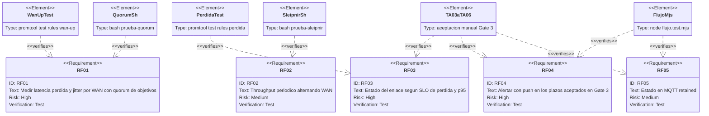
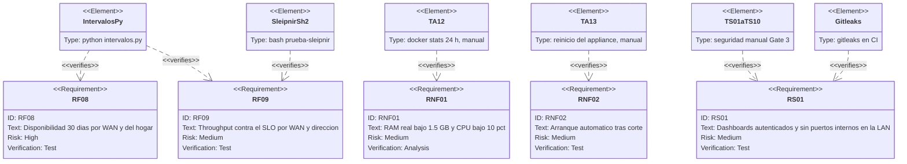

# Inventario de pruebas — Yggdrasil

* **Estado:** review
* **Fecha:** 2026-10-19
* **Decisores:** Jeremi
* **Fase AI-DLC:** 04-testing
* **Versión:** 0.1.0
* **Gate:** 3 (cerrado) → insumo de Gate 4
* **Alcance:** todas las pruebas del repositorio tal como están en `develop` tras la v0.5.13, más las manuales que siguen vigentes
* **Complementa a:** `test-plan.md` (plan y evidencia de Gate 3, aprobado el 2026-09-09)

## Para qué sirve este documento

`test-plan.md` dejó escrito lo que se verificó para cerrar Gate 3 y decía, con razón entonces, que
no había «unidades de código que probar salvo dos scripts y dos nodos function». Desde la 0.4.1 el
proyecto ha ido añadiendo código propio (Thor, el vigía, el respaldo, el guardián, el tablero
Hlidskjalf, la app de la tablet) y con él pruebas que corren en cada PR. Ninguna de esas pruebas
estaba inventariada fuera del CHANGELOG. Aquí están todas, con cómo correrlas en local y qué
cubren, para que Gate 4 pueda apoyarse en un pipeline conocido y no en uno recordado.

Las órdenes locales se ejecutan desde la raíz del repositorio. En Git Bash (Windows), cualquier
orden que pase a `docker` una ruta absoluta del contenedor necesita antes
`export MSYS_NO_PATHCONV=1`; sin eso MSYS la convierte en una ruta de Windows y el fallo parece
del servicio. Las imágenes son las mismas que pinea `deploy/docker-compose.yml`.

## 1. Pruebas automatizadas (CI)

Todas viven en `.github/workflows/validar-configs.yml`, que se dispara en cada PR y push a
`develop`/`main` que toque `deploy/`, `hlidskjalf/` o el propio workflow, y los lunes a las 06:17
UTC solo para el informe de Trivy (`validar-configs.yml:6-18`). Cinco jobs: `configs`, `guardian`,
`hlidskjalf`, `secretos` e `imagenes`. Todos **bloquean** el PR si fallan salvo `imagenes`, que es
informe (`--exit-code 0`).

### 1.1 Job `configs` — configuración validada (equivale al SAST de Gate 2)

| Paso del CI (`validar-configs.yml`) | Fichero(s) | Qué verifica | En local | Cubre |
|---|---|---|---|---|
| Renderizar plantillas (`:39-43`) | `deploy/scripts/render.sh`, `blackbox.yml.tmpl`, `alertmanager.yml.tmpl` | Que las plantillas rinden con IPs de prueba (RFC 5737) y `--sin-recarga` no toca contenedores | `cd deploy && cp .env.example .env && WAN1_IP=192.0.2.101 WAN2_IP=192.0.2.102 ./scripts/render.sh --sin-recarga` | ADR-0005 (render en `sync-host`), hallazgo 0.4.0 (WAN sin IPv4) |
| `docker compose config` base y CD (`:44-48`) | `deploy/docker-compose.yml`, `docker-compose.cd.yml` | Interpolación y sintaxis de los dos Compose | `cd deploy && docker compose config -q && IMAGE_TAG=sha-0000000 docker compose -f docker-compose.cd.yml config -q` | RNF01, RNF02, ADR-0003, ADR-0006 |
| `promtool check config` y `check rules` (`:51-52`) | `prometheus.yml`, `rules/heimdall-recording.yml`, `heimdall-alertas.yml`, `bragi-alertas.yml`, `thor-alertas.yml`, `fafnir-alertas.yml` | Sintaxis y semántica de scrape y de las 14 recording rules y 37 alertas. La lista de ficheros de `check rules` se enumera a mano: una regla nueva hay que añadirla ahí (trampa anotada en 0.5.1 y 0.5.4) | `export MSYS_NO_PATHCONV=1; docker run --rm -v "$PWD/deploy/prometheus:/etc/prometheus:ro" --entrypoint promtool prom/prometheus:v3.14.0 check config /etc/prometheus/prometheus.yml` | RF01, RF03, RF04, RF07, RF08, RF09 |
| `promtool test rules` **thor-alertas** (`:53`) | `deploy/prometheus/tests/thor-alertas.test.yml` | 25 grupos: discrepancias Heimdall/balanceador (`WanSanaFueraDeRuta`, `WanCaidaEnRuta`, con las dos WAN caídas no dispara, una WAN con pérdida fuera de la ruta no es discrepancia hasta 15 min después), `DiscoEmpeora` con pendientes 8→16 y resolución a las 24 h, `DiscoErroresDeCable`, `NasSeLlena`, `NasEspacioCritico`, `NasNoMontado`, `DiscoErroresKernel` con SMART limpio, `PuntoNoMontado`, `RespaldoAtrasado` con dos respaldos; y de otro host (nidavellir): avisos que nombran el host, el NAS sin montar como punto suyo y no como el de midgard, `ThorSinMetricas` de un host colgado, `HostReiniciado` y `ServicioDeHostCaido` | `export MSYS_NO_PATHCONV=1; docker run --rm -v "$PWD/deploy/prometheus:/etc/prometheus:ro" --entrypoint promtool prom/prometheus:v3.14.0 test rules /etc/prometheus/tests/thor-alertas.test.yml` | RCA 2026-10-06 (acción 6), incidente SSD 2026-10-19, NAS al 96 % (2026-10-16), las 18 alertas de Thor |
| `promtool test rules` **wan-up** (`:54`) | `deploy/prometheus/tests/wan-up.test.yml` | 2 grupos: el caso del 2026-10-06 (ping responde, TCP no → caída; sin ping pero 2 de 3 TLS → arriba) y las tres TLS respondiendo | ídem con `/etc/prometheus/tests/wan-up.test.yml` | RF01 (quórum), `wan:up`, `WanCaida`, incidente wan2 2026-10-06 |
| `promtool test rules` **perdida** (`:55`) | `deploy/prometheus/tests/perdida.test.yml` | 4 grupos: un objetivo con 20 % de pérdida no mueve la mediana; pérdida real en los tres se ve entera; TA-05 (objetivo bloqueado no cuenta); los tres caídos no dejan serie | ídem con `/etc/prometheus/tests/perdida.test.yml` | RF03 (pérdida < 1 %), `wan:perdida_pct:5m`, TA-05, cambio 0.5.10 |
| `intervalos.py` (`:57`) | `deploy/prometheus/tests/intervalos.py` | Que ningún grupo de reglas tenga `interval` tal que 2 × intervalo ≥ lookback (300 s): con 5 min las series de 30 d y el SLO de throughput salían vacías | `python3 deploy/prometheus/tests/intervalos.py` | RF08, RF09, hallazgo 0.5.8 (`WanThroughputBajo` ciega) |
| `amtool check-config` (`:60-61`) | `deploy/alertmanager/alertmanager.yml` (renderizado) | Rutas, receptores (`nornas`, `nulo`) e inhibición por WAN | `export MSYS_NO_PATHCONV=1; docker run --rm -v "$PWD/deploy/alertmanager:/cfg:ro" --entrypoint amtool prom/alertmanager:v0.34.0 check-config /cfg/alertmanager.yml` | RF04 |
| `blackbox --config.check` (`:62-63`) | `deploy/blackbox/blackbox.yml` (renderizado) | Los 6 módulos (`icmp_wan1/2`, `tls_wan1/2`, `icmp_hogar`, `tls_hogar`) | `export MSYS_NO_PATHCONV=1; docker run --rm -v "$PWD/deploy/blackbox:/cfg:ro" prom/blackbox-exporter:v0.28.0 --config.check --config.file=/cfg/blackbox.yml` | RF01, `hogar:ruta_up` (0.5.4) |
| `node --check` de Nornas (`:64-67`) | `deploy/nornas/settings.js`, `nornas/init/importar-flujo.mjs` | Solo sintaxis | `export MSYS_NO_PATHCONV=1; docker run --rm -v "$PWD/deploy/nornas:/n:ro" --entrypoint node nodered/node-red:4.1.14-22 --check /n/settings.js` | ADR-0006 |
| Suites de Node (`:68-69`) | `deploy/nornas/tests/flujo.test.mjs` (**15** `test()`), `deploy/nornas/tests/hlidskjalf.test.mjs` (**27** `test()`) | **flujo**: un push por episodio y por huella, resolución con prioridad baja, contrato MQTT de `WanCaida` (push crítico una vez, MQTT en cada lote, aviso de recuperación), `WanDegradada` reenviada cada 4 h sin repetir, `WanNoAptaLlamadas` sin push, olvido a los 7 días, discrepancias con el balanceador sin tocar el estado MQTT, alertas de Thor sin WAN, formato y errores de ntfy. **hlidskjalf**: autorización (503 sin token, 401 con token malo), `secretoIgual` y `consultarJson`, resumen con una sola consulta a Mimir y fuentes caídas, otro host aparte (y colgado, por su `up`), niveles y orden del tablero, apretado de Host sin esconder avisos, bloque de otro host con su cabecera, pie de lo tapado, batería, escape de HTML, máximo tres alertas, WAN caída «desde cuándo», pérdida de Sleipnir, CSP del flujo con exactamente dos hashes | `export MSYS_NO_PATHCONV=1; docker run --rm -v "$PWD/deploy/nornas:/n:ro" --entrypoint node nodered/node-red:4.1.14-22 --test /n/tests/flujo.test.mjs /n/tests/hlidskjalf.test.mjs` | RF04, RF05, ADR-0006, ADR-0007, T4, T6, hallazgos 0.5.6, 0.5.9–0.5.13 |
| JSON y flujo sincronizado (`:70-74`) | `deploy/grafana/dashboards/heimdall-sla.json`, `deploy/nornas/generar-flujo.py`, `nornas/flows/heimdall-alertas.json` | El dashboard es JSON válido; el flujo committeado es exactamente el que genera `src/` (`git diff --exit-code`) | `python3 -m json.tool deploy/grafana/dashboards/heimdall-sla.json > /dev/null && python3 deploy/nornas/generar-flujo.py && git diff --exit-code -- deploy/nornas/flows/` | RF06, revisión del código del flujo en `src/*.js` |
| Montaje de configuraciones (`:75-76`) | `deploy/tests/prueba-montaje-config.sh` | 6 comprobaciones: `blackbox.yml` y `alertmanager.yml` no se montan como fichero suelto, los dos montan su directorio, un reemplazo atómico llega tras `/-/reload` con **blackbox real**, y control negativo (con fichero suelto no llega) | `export MSYS_NO_PATHCONV=1; bash deploy/tests/prueba-montaje-config.sh` (necesita docker y curl) | Hotfix 0.5.7 (`WanCaida` falsa de wan1), 0.4.2 (Mimir) |
| Construir Sleipnir y sync (`:77-81`) | `deploy/sleipnir/Dockerfile`, `deploy/sync/Dockerfile` | Que las dos imágenes propias construyen (base alpine por digest, CLI de Ookla verificada por sha256, `speedtest-cli==2.1.3`) | `cd deploy && docker compose build sleipnir && docker build -q -t yggdrasil-sync:ci sync/` | A03 cadena de suministro, ADR-0005 |
| ShellCheck (`:82-84`) | 26 scripts, enumerados a mano: `scripts/render.sh`, `scripts/deploy.sh`, `sleipnir/sleipnir.sh`, `sleipnir/tests/prueba-sleipnir.sh`, `sync/sync.sh`, `cd/bootstrap-midgard.sh`, `cd/yggdrasil-respaldar.sh`, `cd/yggdrasil-respaldo-aviso.sh`, `cd/yggdrasil-vigia-servicios.sh`, `cd/yggdrasil-thor.sh`, `cd/tests/prueba-thor.sh`, `cd/tests/prueba-vigia-servicios.sh`, `host/wan-balancer.sh`, `host/wan-watchdog.sh`, `host/install-host.sh`, `host/tests/prueba-sandbox-guardian.sh`, `host/tests/prueba-quorum.sh`, `host/tests/prueba-perdida.sh`, `host/medir-tuneles.sh`, `host/pia-tunel.sh`, `host/tests/prueba-pia.sh`, `cd/revisar-adr-0009.sh`, `cd/tests/prueba-revision.sh`, `tests/prueba-montaje-config.sh` (todos bajo `deploy/`) | Nivel `warning` con `koalaman/shellcheck:v0.10.0`. Un script nuevo no entra solo: hay que añadirlo a la lista (anotado en 0.5.4). Hoy falta en la lista `cd/yggdrasil-arranque.sh` (ver huecos) | `export MSYS_NO_PATHCONV=1; docker run --rm -v "$PWD/deploy:/mnt:ro" koalaman/shellcheck:v0.10.0 -S warning /mnt/scripts/render.sh ...` (misma lista) | Calidad de los scripts del host y del CD |

### 1.2 Job `guardian` — pruebas con dobles del código del host

| Paso del CI | Fichero | Qué verifica | En local | Cubre |
|---|---|---|---|---|
| Render dentro del sandbox del guardián (`:92-93`) | `deploy/host/tests/prueba-sandbox-guardian.sh` | Lee `ProtectSystem`/`ReadWritePaths` de la **propia** unidad `wan-watchdog.service`, aplica esas directivas con `systemd-run` y ejecuta `render.sh` como el guardián; control negativo: sin `ReadWritePaths` el render **debe** fallar. Deja `blackbox.yml` atado a las IPs de prueba | Solo en CI o en un Linux con systemd y sin `/srv/apps/yggdrasil`: `sudo bash deploy/host/tests/prueba-sandbox-guardian.sh` | Hallazgo 0.5.6 (`Read-only file system`, `WanCaida` falsa 2026-10-06), ADR-0004 (deuda del acoplamiento) |
| Quórum TCP (`:94-95`) | `deploy/host/tests/prueba-quorum.sh` | Con `ip`, `ping`, `curl` y `logger` simulados: `wan-balancer` y `wan-watchdog` dan la WAN por sana solo con ≥ 2 de 3 destinos HTTPS, los ping no votan (caso 2026-10-06), interfaz sin IP = caída, el fallo parcial se registra una vez y la vuelta también; y los dos usan los **mismos tres destinos** que las sondas TLS de Heimdall y que `wan:up` exige 2 de 3 (unas 18 comprobaciones) | `bash deploy/host/tests/prueba-quorum.sh` | RF01, cambio 0.5.6 «salud por mayoría TCP», `WanSanaFueraDeRuta`/`WanCaidaEnRuta` (mismo criterio) |
| Ventana de pérdida (`:96-97`) | `deploy/host/tests/prueba-perdida.sh` | Con `ip`, `ping`, `curl` y `logger` simulados, **42** comprobaciones de `wan-balancer`: una WAN con TCP sano y 20 % de pérdida sale de la ruta en 10 vueltas (caso 2026-10-21) y lo registra con su motivo; con pérdida sostenida sigue fuera y vuelve solo con la ventana limpia; un objetivo que nunca contesta, un ping suelto o un único fallo TCP no la sacan; 2 fallos TCP seguidos sí, y vuelve con 6 aciertos porque los ping del corte no cuentan; con las dos fuera la ruta va por la menos mala (la que responde por TCP, o la que pierde 2 ping menos) y en un corte de las dos se queda la actual; `check` solo apunta ping con mayoría TCP; y `PERDIDA_ICMP` son los mismos objetivos que las sondas ICMP de Heimdall | `bash deploy/host/tests/prueba-perdida.sh` | RF01, cambio «ventana de pérdida del balanceador» (2026-10-21), `WanSanaFueraDeRuta` |
| Túnel PIA (`:98-101`) | `deploy/host/tests/prueba-pia.sh` | Con `curl`, `wg`, `ip`, `nft`, `ping`, `dnsmasq` y `logger` simulados, **69** comprobaciones de `pia-tunel.sh`: contadores de sondas solo con el desvío activo, RTT, levantamientos y rechazos; usuario, contraseña (con comillas, `$`, backticks y `&`), token y clave privada llegan por descriptor y nunca aparecen en la línea de órdenes ni en el journal; addKey contra el servidor de la región con el certificado de PIA; MTU 1380; tabla `inet yggdrasil_pia` con la MAC en minúsculas, marca de todo el IPv4, descarte de IPv6 hacia fuera, DNS al reenviador de midgard (`casa.lan`, sin dominio y la inversa a la casa; el resto al DNS de PIA por una ruta `/32` por `pia0`), vuelta al DNS de PIA si el reenviador no arranca, y masquerade por `pia0`; reglas 87/88; 3 sondas fallidas retiran el desvío y vuelve cuando el túnel responde; tabla borrada desde fuera se reaplica; MAC inválidas ignoradas; `PIA_MACS` vacía sin desvío; addKey o token rechazados no dejan túnel; la parada deja los equipos en directo y para el reenviador. En el CI, además, `nft -c` valida la tabla real con los dos destinos del DNS | `NFT_REAL=1 sudo -E bash deploy/host/tests/prueba-pia.sh` (necesita jq y nft) | ADR-0009, T11 |
| Fáfnir (`guardian`) | `deploy/fafnir/tests/test_fafnir.py` | **18** pruebas de `unittest` sobre árboles temporales con dos hosts, tres medios (uno en riesgo) y un externo opcional sin conectar: inventario, exclusiones y papeleras; huella rápida y completa, y su reutilización; la misma película en tres discos es un contenido; copias por medio, riesgo y política; reglas recalculadas al catalogar; informe y métricas; `mover` con verificación, sin borrar si una copia no coincide; la configuración de ejemplo | `python3 -m unittest discover -s deploy/fafnir/tests -v` | ADR-0010 |
| `promtool test rules` **fafnir-alertas** | `deploy/prometheus/tests/fafnir-alertas.test.yml` | 4 grupos: datos en riesgo sin repetir el aviso de política, colección sin copias, inventario viejo solo de ubicaciones fijas, sin fichero de métricas | `export MSYS_NO_PATHCONV=1; docker run --rm -v "$PWD/deploy/prometheus:/etc/prometheus:ro" --entrypoint promtool prom/prometheus:v3.14.0 test rules /etc/prometheus/tests/fafnir-alertas.test.yml` | ADR-0010 |
| Thor (`:102-103`) | `deploy/cd/tests/prueba-thor.sh` | **98** aserciones sobre el `host.prom` que deja el recolector con `smartctl`, `df`, `timeout`, `ip`, `docker`, `systemctl` y `journalctl` simulados: atributos SMART (solo los de la lista, salud PASSED con código 64), NAS montado/no montado/`df` colgado, raíz, WAN en la ruta y multipath, contenedores sano/sin healthcheck/unhealthy/parado/en pausa/inexistente, nombres temporales de Compose fuera, unidades activa/inactiva/no instalada, respaldos por nombre y marcas inválidas, rutas `by-id`, disco mecánico/SSD, errores del kernel por puerto SATA, `journalctl` fallando no publica un 0, arranque (`btime`) y temperatura del procesador, `THOR_WANS` vacía | `bash deploy/cd/tests/prueba-thor.sh` | Las 14 métricas de Thor, hallazgos 0.5.8, 0.5.9, 0.5.11 (nombres temporales), 0.5.12 (SSD, `by-id`), 0.5.13 (respaldos) |
| Baldr | `deploy/cd/tests/prueba-baldr.sh` | **60** comprobaciones con `systemctl`, `journalctl`, `docker`, `curl`, `findmnt` y `timedatectl` simulados, sobre el apagón del 2026-10-28: ventana y duración del corte, apagado limpio frente a corte, NAS que no responde, montaje que se recupera y montaje que no, arranque que converge al reintentar y arranque que sigue fallando, contenedor muerto en el arranque frente a parado a mano o de un solo uso, jobs relanzados solo si corrieron antes de tiempo o fallaron, Sleipnir reiniciado solo tras un corte, alertas esperables frente a pendientes, otro host con pendientes, push con el resumen; reinicio ordenado sin push; `verificar` sin relanzar ni avisar, sin pasada previa (calcula la ventana), en un host sin Mimir (no consulta Gjallarhorn) y a mano (lee la configuración del host); primer arranque registrado; un disco que monta tarde (se espera) y uno que no llega; registro ilegible a tiempo (corte sin hora, sin colgarse). Necesita `jq` |
| Revisión de la ADR-0009 (`:104-105`) | `deploy/cd/tests/prueba-revision.sh` | Con Mimir y ntfy simulados, **21** comprobaciones de `revisar-adr-0009.sh`: túnel sano → mantener la Fase 1; 10 días → datos insuficientes; 45 min con pérdida ≥ 1 % → proponer la Fase 2; túnel 35 ms más lento o 0,9 puntos más de pérdida que la WAN de referencia (la que menos pierde, no la rápida y degradada) → valorar revertir; rechazos de PIA y horas sin desvío como hallazgos que no cambian la propuesta; Mimir caído → sin datos y código de error; con `--aviso`, informe guardado y push con la propuesta en el título sin que el tema de ntfy aparezca en la salida | `bash deploy/cd/tests/prueba-revision.sh` (necesita jq) | ADR-0009 (condiciones de revisión), issue #88 |
| Vigía de servicios (`:106-107`) | `deploy/cd/tests/prueba-vigia-servicios.sh` | **22** comprobaciones con `docker`, `systemctl`, `curl` y `hostname` simulados: umbral de 2 fallos, un push por pasada, recordatorio a las 6 h, aviso de recuperación, contenedor inexistente, unidad inactiva, `paused` cuenta como en marcha, Docker caído avisa solo de Docker, sin Compose usa el inventario anterior, push fallido se reintenta, 10 min de gracia tras arrancar, y el tema de ntfy nunca aparece en un push | `bash deploy/cd/tests/prueba-vigia-servicios.sh` (necesita jq) | Vigía 0.5.6, protección del tema de ntfy (credencial) |
| Sleipnir en sus tres modos (`:108-109`) | `deploy/sleipnir/tests/prueba-sleipnir.sh` | **10** casos que corren `sleipnir.sh` entero dos ciclos con `speedtest`, `speedtest-cli`, `iperf3`, `ip`, `httpd` y `sleep` simulados: `speedtest-cli` ok y fallando, `iperf3` con y sin puerto, sin servidor, servidor ocupado (sin latencia inventada), `ookla` con dos servidores, modo por defecto, modo desconocido no mide, WAN sin IPv4 | `bash deploy/sleipnir/tests/prueba-sleipnir.sh` | RF02, RF09, `wan_throughput_*`, hotfix 0.5.11 (modos borrados en 0.4.5) |

### 1.3 Job `hlidskjalf` — la app de la tablet y la vista previa

| Paso del CI | Fichero | Qué verifica | En local | Cubre |
|---|---|---|---|---|
| Compilar y firmar el APK (`:117-122`) | `hlidskjalf/construir.sh`, `hlidskjalf/app/` | Que el APK compila sin Gradle (aapt2, javac 17, d8, apksigner) con `platforms;android-25` y `build-tools;34.0.0`; en CI firma con una clave efímera, solo para probar que compila | `ANDROID_HOME=<sdk> bash hlidskjalf/construir.sh` (ver `hlidskjalf/README.md`, sección «Compilar») | ADR-0007 |
| ShellCheck de la tablet (`:123-124`) | `hlidskjalf/construir.sh`, `instalar.sh`, `vista-previa.sh` | Nivel `warning` | `export MSYS_NO_PATHCONV=1; docker run --rm -v "$PWD/hlidskjalf:/mnt:ro" koalaman/shellcheck:v0.10.0 -S warning /mnt/construir.sh /mnt/instalar.sh /mnt/vista-previa.sh` | — |
| Vista previa (`:129-132`) | `hlidskjalf/vista-previa.py`, `hlidskjalf/escenarios/*.json` | `py_compile` del servidor y JSON válido de los 4 escenarios (`normal`, `wan2-caida`, `estres`, `extremo`) | `python3 -m py_compile hlidskjalf/vista-previa.py && for f in hlidskjalf/escenarios/*.json; do python3 -m json.tool "$f" > /dev/null; done` | PR #77; la prueba de verdad del tablero en la tablet es manual (§2.2) |

### 1.4 Job `secretos` — gitleaks (bloquea)

`validar-configs.yml:134-143`: `zricethezav/gitleaks:v8.28.0 detect` sobre **todo el historial**
(`fetch-depth: 0`) con `--exit-code 1`. En local:
`export MSYS_NO_PATHCONV=1; docker run --rm -v "$PWD:/repo" zricethezav/gitleaks:v8.28.0 detect --source /repo --no-banner --redact --exit-code 1`.
Cubre A05/A02 (secretos fuera del repo), TS-08.

### 1.5 Job `imagenes` — Trivy (solo informe, no bloquea)

`validar-configs.yml:141-153`: `aquasec/trivy:0.66.0 config` sobre `deploy/` (misconfiguraciones
HIGH/CRITICAL) y `trivy image` de las 6 imágenes de terceros pineadas, ambas con `--exit-code 0`.
Es el único job que corre también en el disparo semanal. **No bloquea**: la política de triaje de
`docs/03-implementation/cadena-suministro.md` (punto 5) dejó el filtro bloqueante «para Gate 3» y
sigue sin implementarse. Las dos imágenes propias no se escanean en este job (se construyen en
`configs`, pero sin `trivy image` posterior). En local:
`export MSYS_NO_PATHCONV=1; docker run --rm -v "$PWD/deploy:/deploy:ro" aquasec/trivy:0.66.0 config --severity HIGH,CRITICAL /deploy`.
Cubre A03 (informe), A06.

### 1.6 Guardia de GitFlow

`.github/workflows/gitflow-guard.yml`: en cada PR hacia `main` comprueba que la rama de origen es
`develop`, `release/*` o `hotfix/*` y que no viene de un fork. Es el status check requerido por el
ruleset de `main`. No prueba código, pero es la única puerta automática que separa `develop` de
producción, porque todo merge en `main` despliega (§1.7).

### 1.7 El despliegue como prueba de integración

`.github/workflows/build-and-push.yml` no es una prueba, pero cada push a `main` ejerce el camino
completo: build de `yggdrasil-sleipnir` y `yggdrasil-sync` (salvo si el tag `sha-<7>` ya está
publicado, `:43-54`), `workflow_run` firmado al receptor, `pull` + `up -d`, `sync-host`,
`sync-net`, healthcheck de Odín y rollback. Su evidencia de referencia es TA-01
(`test-plan.md:218-223`). Ver `docs/05-deployment/deployment.md`.

## 2. Pruebas manuales y HITL vigentes

### 2.1 Aceptación de Gate 3 que sigue siendo repetible

Los casos de `test-plan.md:201-216` se ejecutaron el 2026-09-06/09 y quedan como procedimiento
para cualquier cambio que toque reglas, flujo o red. Los que conviene repetir tras un cambio
relevante:

| Caso | Cuándo repetirlo | Cómo (resumen; el detalle está en `test-plan.md`) |
|---|---|---|
| TA-02 sondas por WAN | tras tocar `blackbox.yml.tmpl`, `prometheus.yml` o `render.sh` | `probe_success{job=~"blackbox_.*"}` por `wan` y `target`: hoy 12 series (2 WAN × 6 objetivos) más 3 del hogar |
| TA-03 / TA-14 caída y recuperación | tras tocar `wan:up`, `WanCaida` o el traductor de Nornas | `ip link set wan2 down` y cronometrar alerta, MQTT y push; subir y ver `recuperando → saludable` |
| TA-04 / TA-11 degradación y llamadas | tras tocar `wan:perdida_pct:5m`, percentiles o `WanDegradada` | `tc qdisc add dev wan1 root netem loss 5%` / `delay 250ms`, 6 min |
| TA-05 quórum | tras cambiar objetivos | bloquear un objetivo con nftables 5 min: sin `WanCaida` ni `WanDegradada` |
| TA-06 MQTT | tras tocar el flujo | `mosquitto_sub -u iot -t 'midgard/#' -v` |
| TA-07 throughput | tras tocar Sleipnir o su regla | esperar dos ciclos (6 h) y contrastar con la CLI de Ookla a mano |
| TA-12 RNF01 | tras añadir un servicio al Compose | `docker stats --no-stream` cada hora 24 h; criterio ≤ 1,5 GB reales |
| TA-13 RNF02 | tras tocar `yggdrasil-arranque.*` o el Compose | reinicio del appliance; los servicios vuelven y Odín responde |
| TS-01 a TS-10 seguridad | tras publicar un puerto, cambiar ACL, usuario o imagen | `nmap` desde la LAN, `curl` a 9090/9093, `mosquitto_pub` anónimo y por usuario, webhook sin Bearer, `docker inspect` de usuario y capacidades, digests contra `imagenes.md` |

**TS-02 sigue con evidencia indirecta**: el `nmap` desde fuera de la red (datos móviles) quedó
como HITL en Gate 3 (`test-plan.md:339`) y no se ha hecho. Pasa a Gate 4.

### 2.2 El tablero en la tablet real: `hlidskjalf/vista-previa.sh` (PR #77)

Prueba de diseño, no de CI. Con la tablet por USB y `adb` autorizado, sin desplegar nada:

```sh
python3 hlidskjalf/vista-previa.py                       # en otra terminal; puerto 8099
bash hlidskjalf/vista-previa.sh abrir                    # guarda la URL de producción (con el token) en files/url.orig
bash hlidskjalf/vista-previa.sh probar hlidskjalf/escenarios/estres.json
bash hlidskjalf/vista-previa.sh probar hlidskjalf/escenarios/extremo.json
bash hlidskjalf/vista-previa.sh cerrar                   # restaura la URL de producción
```

`probar` recarga la tablet con el escenario, espera la medida del medidor que la página lleva en
vista previa, guarda la captura en `hlidskjalf/build/vista-previa/` y **sale con 1 si alguna fila
queda recortada, tapada o fuera de pantalla**. Los cuatro escenarios cubren: todo en orden,
wan2 caída (resumen real del 2026-10-19), estrés (cinco alertas, SSD con errores, NAS al 2,8 %,
respaldo atrasado, Thor sin datos, cinco servicios caídos; la 0.5.12 perdía cuatro filas) y extremo
(once servicios caídos). Hay que ejecutarla ante cualquier cambio de `deploy/nornas/hlidskjalf/`
y terminar siempre con `cerrar`, o la tablet se queda mirando al PC.

### 2.3 Verificación tras cada despliegue

Lo que se mira en midgard después de que el receptor despliegue (`deploy/cd/README.md:82-87`):

```sh
curl -s http://127.0.0.1:9000/status | jq '.apps.yggdrasil'      # estado y tag desplegado
journalctl -u cd-receiver -n 50 --no-pager
docker logs yggdrasil-sync-host --tail 20 && docker logs yggdrasil-sync-net --tail 5
docker compose -f /srv/apps/yggdrasil/deploy/docker-compose.cd.yml -p yggdrasil ps
```

Más `up{job="thor"}` en Mimir y un vistazo a Hlidskjalf: si el resumen tiene una fuente caída, el
tablero lo dice en la cabecera. El resultado de `sync-host`/`sync-net` **no** forma parte del
healthcheck del receptor (ADR-0005), así que estos logs son la única comprobación de que el
render y las recargas ocurrieron.

## 3. Trazabilidad requisito ↔ prueba (estado actual)


*Eje trazabilidad · fase 04 · medición y alertado. El jitter de RF01 no tiene prueba porque no está implementado (§4).*


*Eje trazabilidad · fase 04 · observabilidad, no funcionales y seguridad.*

Resumen: RF01 (salvo jitter), RF02, RF03, RF04, RF05, RF08 y RF09 tienen al menos una prueba
automática en CI además de la aceptación manual de Gate 3. RF06, RF07, RNF01, RNF02 y RS01 solo
tienen verificación manual (TA-08, TA-09, TA-12, TA-13, TS-01…TS-10).

## 4. Huecos: lo que no tiene prueba

Cada línea es un hueco conocido a la fecha. Los tres primeros son hallazgos de la auditoría
documental del 2026-10-19; el resto salen de leer el CI contra el código.

- **Jitter (RF01).** No existe métrica, regla ni panel de jitter en `deploy/`; Sleipnir recibe el de Ookla y no lo publica. Decisión HITL del 2026-10-19: se implementa en un PR posterior (`wan:jitter_ms:5m` como desviación típica del RTT ICMP en 5 min por objetivo, mediana por WAN; y el jitter de Ookla publicado por Sleipnir). Hasta entonces, RF01 está parcialmente sin verificar.
- **`SondaCaida` no cubre las sondas del hogar.** `heimdall-alertas.yml:89` vigila `up{job=~"blackbox_.*|huginn_muninn|sleipnir"}`; los jobs `hogar_icmp` y `hogar_tls` quedan fuera, y nada avisa si Mimir deja de scrapearlos. Sin prueba de promtool para `SondaCaida`.
- **Umbral fijo de 800 en el panel de throughput de Odín.** `heimdall-sla.json` pinta `wan_throughput_mbps` con umbral rojo/verde en 800 y no usa `wan:slo_throughput_mbps`: la subida de wan2 (SLO 400, medida ~475) sale en rojo estando en objetivo. Ninguna prueba compara el dashboard con las reglas.
- **`WanThroughputBajo`, `SleipnirSinMedicion`, `SondaCaida` y `HogarSinRuta`** no tienen casos en `promtool test rules`; solo `wan:up`, `wan:perdida_pct:5m` y las 16 de Thor los tienen. Las 8 de Bragi se prueban en `higerotech/bragi`, aquí es una copia sin prueba.
- **`wan:latencia_p9x:5m`, `wan:apto_llamadas`, `wan:disponibilidad:30d` y `hogar:ruta_up`** solo están verificadas por la aceptación manual de Gate 3 (TA-09, TA-10, TA-11) y por `intervalos.py` en lo que respecta a su intervalo.
- **`yggdrasil-arranque.sh` no pasa por ShellCheck** (no está en la lista de `validar-configs.yml:84`) y no tiene prueba con dobles; su verificación es TA-13.
- **`yggdrasil-respaldar.sh` y `yggdrasil-respaldo-aviso.sh`** pasan ShellCheck pero no tienen prueba funcional (ni del archivo, ni de la suma, ni de la retención, ni de la **restauración**). La restauración nunca se ha ejecutado; el procedimiento está escrito en `deploy/cd/README.md:163-169`.
- **`wan-balancer.sh`** solo tiene probado `check()` (quórum) en `prueba-quorum.sh`; `apply_default`, `main_default_ok`, `podar_reglas_origen` y la poda IPv6 (hallazgos 0.5.4 y 0.5.5) no tienen prueba.
- **`wan-watchdog.sh`** tiene probados `sondear_wan` y el render en sandbox; la lógica de remedio (reiniciar `wan-balancer` o `dnsmasq`, cooldown de 3 por hora) no.
- **Rollback automático del receptor** nunca se ha ejercido con un fallo real: en TA-01 el healthcheck agotado ocurrió sin `previous_tag` registrado (`test-plan.md:222-223`). Pasa a Gate 4.
- **Trivy no bloquea** (`--exit-code 0`) y no escanea las imágenes propias ya construidas; el filtro con `.trivyignore` previsto en `cadena-suministro.md` (punto 5) no existe.
- **Tablero Hlidskjalf en la tablet**: la prueba real es manual (§2.2); el CI solo compila el APK y valida los JSON. El APK no tiene prueba instrumentada.
- **Nornas `settings.js`**: solo `node --check`; `adminAuth`, `consultarJson` y `secretoIgual` se prueban indirectamente en `hlidskjalf.test.mjs`.
- **`render.sh`**: su rama «WAN sin IPv4 conserva la IP anterior» (0.4.0) no tiene prueba; `prueba-sandbox-guardian.sh` solo prueba el camino feliz dentro del sandbox.
- **TS-02 desde fuera de la red**: pendiente desde Gate 3.
- **El resultado de `sync-host`/`sync-net`** no forma parte de ningún healthcheck ni prueba automática; se lee en `docker logs` tras cada despliegue (§2.3).
