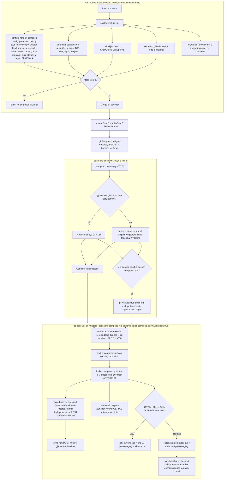
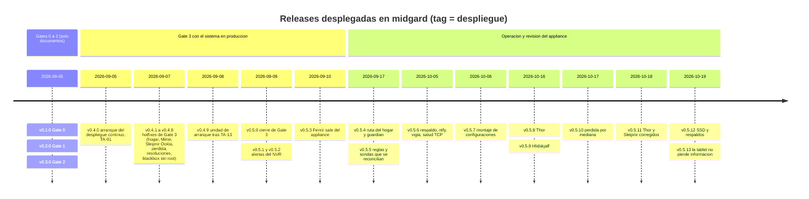

# Despliegue — Yggdrasil en midgard

* **Estado:** review
* **Fecha:** 2026-10-19
* **Decisores:** Jeremi
* **Fase AI-DLC:** 05-deployment
* **Versión:** 0.1.0
* **Gate:** 4
* **Entorno objetivo:** midgard (Ubuntu Server 24.04, i3-3240, 8 GB; router dual-WAN de la casa), un único entorno: no hay staging
* **Estrategia de release:** GitFlow; cada merge en `main` lleva tag `vX.Y.Z` y despliega solo, por SHA, con healthcheck y rollback (ADR-0005). Releases pequeñas y frecuentes (27 tags entre el 2026-09-05 y el 2026-10-19)
* **ADRs relacionadas:** ADR-0002 (placement), ADR-0003 (red), ADR-0005 (despliegue continuo), ADR-0006 (Ratatosk y Nornas), ADR-0007 (Hlidskjalf)

## Qué formaliza este documento

Yggdrasil se despliega de forma continua desde la `v0.4.0` (2026-09-05): esa release abrió Gate 3
y su primer despliegue automático fue la prueba TA-01. Desde entonces han entrado en producción
23 releases más sin que la fase 05 tuviera documento ni gate. Este documento recoge **cómo se
despliega de verdad** —leído de `deploy/cd/`, `deploy/scripts/` y los workflows, no de memoria—,
dónde corre cada pieza, qué hacer cuando algo sale mal y qué controles del pipeline existen y
cuáles no. Es la evidencia de Gate 4 (`.ai-dlc/gates/gate-4-deployment.md`).

## 1. Dónde corre cada cosa (C4 Deployment)

```mermaid
C4Deployment
    title Despliegue de Yggdrasil — midgard, GitHub y la casa
    Deployment_Node(github, "GitHub", "SaaS") {
        Container(actions, "GitHub Actions", "validar-configs, build, gitflow-guard", "Valida en cada PR; construye en cada push a main")
        ContainerDb(ghcr, "GHCR", "registro OCI", "yggdrasil-sleipnir y yggdrasil-sync, tag sha-7")
    }
    Deployment_Node(cf, "Cloudflare Tunnel", "deploy.higerotech.com") {
        Container(hook, "Webhook workflow_run", "HTTPS, firma HMAC", "Llega al receptor en 127.0.0.1:9000")
    }
    Deployment_Node(midgard, "midgard", "Ubuntu Server 24.04, Docker + Compose") {
        Deployment_Node(systemd, "systemd (host)", "unidades y temporizadores") {
            Container(receptor, "cd-receiver", "despliegue-continuo", "pull, up -d, healthcheck, rollback")
            Container(balancer, "wan-balancer", "bash, cada 5 s", "Multipath wan1/wan2 por mayoria TCP")
            Container(watchdog, "wan-watchdog.timer", "bash, cada minuto", "Ruta main, DNS, reconcilia sondas")
            Container(thorsh, "yggdrasil-thor.timer", "bash, cada minuto", "Escribe host.prom")
            Container(vigia, "yggdrasil-vigia-servicios.timer", "bash, cada minuto", "Aviso directo a ntfy")
            Container(respaldo, "yggdrasil-respaldo.timer", "bash, 22:30 Caracas", "tar de volumenes y despliegue al NAS")
            Container(arranque, "yggdrasil-arranque.service", "bash, al arrancar", "compose up -d con el tag del receptor")
        }
        Deployment_Node(hostnet, "network_mode host", "escuchan en docker0 172.17.0.1") {
            Container(blackbox, "Huginn y Muninn", "blackbox_exporter :9115", "ICMP y TLS con IP de origen por WAN")
            Container(sleipnir, "Sleipnir", "CLI de Ookla + httpd :9469", "Throughput, una WAN cada 3 h")
            Container(synchost, "sync-host", "yggdrasil-sync, un solo uso", "checkout del SHA, render, recarga blackbox")
        }
        Deployment_Node(heimdallnet, "red yggdrasil_heimdall", "bridge interno, sin puertos salvo los publicados en la IP LAN") {
            Container(mimir, "Mimir", "Prometheus :9090", "TSDB 30 d, reglas")
            Container(gjallarhorn, "Gjallarhorn", "Alertmanager :9093", "Rutas, inhibicion, webhook")
            Container(odin, "Odin", "Grafana, LAN :3000", "Dashboard y health_url")
            Container(ratatosk, "Ratatosk", "Mosquitto, LAN :1883", "Bus MQTT con ACL")
            Container(nornas, "Nornas", "Node-RED, LAN :1880", "Flujo Heimdall, ntfy, Hlidskjalf")
            Container(thor, "Thor", "httpd :9471", "Sirve host.prom a Mimir")
            Container(syncnet, "sync-net", "yggdrasil-sync, un solo uso", "Recarga Mimir y Gjallarhorn")
        }
    }
    Deployment_Node(nas, "NAS", "NFS /mnt/nas/respaldos") {
        ContainerDb(archivo, "yggdrasil-UTC.tar.gz", "14 archivos, 700/600", "Volumenes, deploy con .env, config del router")
    }
    Deployment_Node(tablet, "Galaxy Tab 2 en la pared", "Android 7.1, WebView 81, Wi-Fi") {
        Container(hlidskjalf, "Hlidskjalf", "APK kiosco", "GET /hlidskjalf/ y /resumen con Bearer de lectura")
    }
    System_Ext(isp1, "ISP 1 (wan1)", "1000/1000 Mbps")
    System_Ext(isp2, "ISP 2 (wan2)", "1000/500 Mbps, adaptador USB")
    System_Ext(ntfy, "ntfy", "Tema privado de la casa")
    Rel(actions, ghcr, "push imagenes", "sha-7")
    Rel(actions, hook, "workflow_run firmado", "HTTPS")
    Rel(hook, receptor, "despliega ese SHA", "localhost 9000")
    Rel(receptor, ghcr, "pull", "anonimo")
    Rel(synchost, github, "git fetch y checkout", "HTTPS")
    Rel(mimir, blackbox, "scrape", "host.docker.internal:9115")
    Rel(mimir, thor, "scrape", "thor:9471")
    Rel(blackbox, isp1, "sondea", "source wan1")
    Rel(blackbox, isp2, "sondea", "source wan2")
    Rel(nornas, ntfy, "push de alertas", "HTTPS")
    Rel(vigia, ntfy, "aviso directo", "HTTPS")
    Rel(respaldo, archivo, "escribe y verifica sha256", "NFS")
    Rel(hlidskjalf, nornas, "resumen", "HTTP LAN + Bearer")
    UpdateLayoutConfig($c4ShapeInRow="3", $c4BoundaryInRow="2")
```
*Eje estructura · fase 05 · evidencia Gate 4. Fuentes: `deploy/docker-compose.yml`, `docker-compose.cd.yml`, `deploy/cd/*.service|*.timer`, `deploy/host/*.service|*.timer`, ADR-0005.*

Notas de la topología:

- **Un solo host.** Todo lo de Yggdrasil corre en midgard; GitHub solo construye y avisa. No hay
  entorno de pruebas intermedio: la primera ejecución de un cambio en producción es el propio
  despliegue, y por eso las pruebas con dobles del CI (`docs/04-testing/inventario-pruebas.md`) y
  la vista previa de la tablet son el único colchón.
- **Dos regímenes de red** (ADR-0003): las sondas y `sync-host` en host-mode, ligadas a la IP de
  docker0; el resto en `yggdrasil_heimdall`, con solo 3000, 1880 y 1883 publicados en la IP LAN.
- **Lo que no despliega el receptor**: `deploy/host/` (router: balanceador y guardián) se instala
  con `install-host.sh`; las unidades de `deploy/cd/` (arranque, respaldo, vigía, Thor) las instala
  `bootstrap-midgard.sh` una vez, y **no se actualizan solas** con cada release: un cambio en esos
  scripts exige volver a ejecutar el bootstrap o `install-host.sh` en midgard (ver §3.5).

## 2. El pipeline, tal como está escrito


*Eje comportamiento · fase 05 · evidencia Gate 4. Fuentes: `.github/workflows/validar-configs.yml`, `build-and-push.yml`, `gitflow-guard.yml`, `deploy/cd/apps.yggdrasil.yml`, `deploy/sync/sync.sh`, `deploy/docker-compose.cd.yml`, ADR-0005.*

Lo que conviene saber del dibujo:

- **Qué bloquea y qué no.** Cuatro jobs del CI bloquean el PR; `imagenes` (Trivy) es informe con
  `--exit-code 0` y es el único que corre también el lunes a las 06:17 UTC. `gitflow-guard` es el
  status check obligatorio del ruleset de `main`.
- **Desfase del Compose.** El receptor levanta el stack con el `docker-compose*.yml` del checkout
  anterior, porque `sync-host` actualiza el clon durante ese mismo despliegue
  (`deploy/cd/README.md:69-73`). El job `redespliegue` lo compensa relanzando `build` si el commit
  tocó el Compose; desde la 0.5.12 ese relanzamiento no reconstruye las imágenes, así que el segundo
  despliegue solo recrea lo que cambió.
- **Healthcheck parcial.** El receptor solo mira Odín (`health_url`, 300 s por el primer arranque
  de Grafana en el HDD). El resultado de `sync-host`, `sync-net` y `nornas-init` **no** cuenta: si
  el render falla, el despliegue sale `ok` y las sondas siguen con la configuración vieja. Se lee en
  `docker logs yggdrasil-sync-host` (§3.1).
- **Las configuraciones viajan con el SHA.** Un rollback del receptor vuelve al tag anterior y
  `sync-host` hace checkout de ese commit: reglas, plantillas y dashboard vuelven también
  (ADR-0005). Lo que **no** vuelve: los volúmenes de datos, `deploy/.env` y las unidades del host.

## 3. Runbook

Todo lo que sigue se ejecuta en midgard por SSH (`jalcala@midgard`), salvo que se indique. Ninguna
orden imprime secretos; las que tocan `.env` o `receiver.env` solo cuentan o comparan.

### 3.1 Comprobar un despliegue

```sh
curl -s http://127.0.0.1:9000/status | jq '.apps.yggdrasil'          # estado, current_tag, previous_tag
journalctl -u cd-receiver -n 50 --no-pager
docker logs yggdrasil-sync-host --tail 20 && docker logs yggdrasil-sync-net --tail 5
docker compose -f /srv/apps/yggdrasil/deploy/docker-compose.cd.yml -p yggdrasil ps
```

`sync-host` debe terminar en `listo` tras `checkout <sha>: <mensaje>` y `blackbox recargado`;
`sync-net` con `mimir recargado` y `gjallarhorn recargado`. Si Grafana recién migrada agota el
healthcheck con todos los contenedores `Up`, no es un fallo del stack (`deploy/cd/README.md:75-77`).

### 3.2 Volver a una versión anterior (rollback)

Tres caminos, del más limpio al de contingencia:

1. **Automático.** `rollback: true` en `apps.yml` (`deploy/cd/apps.yggdrasil.yml:15`): si Odín no
   responde `200` en 300 s, el receptor vuelve a `previous_tag`. No hay que hacer nada; comprobar
   con §3.1 que `current_tag` es el anterior y que `sync-host` hizo checkout de ese commit.
2. **Relanzar el build del commit bueno.** En GitHub, la ejecución del workflow `build` de la
   release anterior; desde tu equipo: `gh run list --workflow build --limit 10` y
   `gh run rerun <id>`. Su `workflow_run` vuelve a llegar al receptor, que despliega ese SHA (es lo
   que se hizo en TA-01, `docs/04-testing/test-plan.md:222-223`). Como `build` no reconstruye una
   imagen ya publicada, el redespliegue es rápido y recrea solo lo que cambia.
3. **Por GitFlow.** Si lo que hay que deshacer es el cambio y no solo el despliegue:
   `hotfix/X.Y.Z` desde `main` con el `git revert`, PR hacia `main`, tag y back-merge a `develop`.
   Es el camino que deja CHANGELOG y tags coherentes.

Contingencia **sin receptor** (`deploy/cd/README.md:89-91`, `deploy/scripts/deploy.sh`): en
midgard, como `deploy`, `cd /srv/apps/yggdrasil/deploy && IMAGE_TAG=sha-<7> ./scripts/deploy.sh`
con un SHA ya publicado en GHCR. `deploy.sh` hace `git pull --ff-only`, `render.sh`, `pull`,
`build sleipnir` y `up -d --remove-orphans`: trae **la punta de `main`**, no el commit del tag,
así que solo sirve para redesplegar lo último, no para volver atrás. Para volver atrás sin
receptor hay que hacer `git checkout <sha>` a mano antes de `render.sh` y `up -d`.

Lo que un rollback **no** deshace: una migración de datos de Grafana (volumen `odin-datos`), un
cambio en `deploy/.env`, o las unidades del host. Para eso está §3.3.

### 3.3 Restaurar desde el respaldo del NAS

El respaldo nocturno (`deploy/cd/yggdrasil-respaldar.sh`, 22:30 hora de Caracas, `Persistent=true`)
deja en `/mnt/nas/respaldos/yggdrasil/yggdrasil-<UTC>.tar.gz` y su `.sha256` los seis volúmenes
(`mimir-datos`, `odin-datos`, `gjallarhorn-datos`, `nornas-datos`, `ratatosk-datos`,
`sleipnir-datos`), `despliegue.tar` (`/srv/apps/yggdrasil/deploy` **con `.env`** y los renderizados),
`yggdrasil.json` (la etiqueta del receptor) y `host/host.tar` (nftables, sysctl, netplan, `apps.yml`
y las unidades y scripts de WAN y Yggdrasil). Conserva los 14 más recientes y no borra nada si la
subida del día no verificó su suma.

Restauración (`deploy/cd/README.md:163-169`), con el stack parado:

```sh
cd /mnt/nas/respaldos/yggdrasil && sha256sum -c yggdrasil-<UTC>.tar.gz.sha256   # primero la suma
docker compose -f /srv/apps/yggdrasil/deploy/docker-compose.yml -p yggdrasil stop
tar -xzf yggdrasil-<UTC>.tar.gz -C /tmp/restaurar          # deja /tmp/restaurar/r/
tar -C /var/lib/docker/volumes/yggdrasil_mimir-datos/_data --numeric-owner -xpf /tmp/restaurar/r/volumenes/mimir-datos.tar
# ...igual con odin-datos, gjallarhorn-datos, nornas-datos, ratatosk-datos y sleipnir-datos
# despliegue.tar va en /srv/apps/yggdrasil (contiene deploy/ con .env: mantener 0600 y dueño deploy)
sudo systemctl start yggdrasil-arranque.service             # converge el stack con el tag registrado
```

**Este procedimiento no se ha ejecutado nunca** sobre midgard ni sobre una máquina de prueba. Es
uno de los ítems abiertos de Gate 4: hasta que se ensaye, el respaldo es una promesa.

Avisos del respaldo: `OnFailure=` manda push inmediato y `yggdrasil-respaldo-vigia.timer` avisa a
las 08:00 si el último éxito tiene más de 26 h; Thor publica además
`yggdrasil_respaldo_ultimo_exito_timestamp_seconds{respaldo}` y `RespaldoAtrasado` dispara a las
30 h. Comprobación del canal: `sudo /usr/local/sbin/yggdrasil-respaldo-aviso.sh prueba`.

### 3.4 Arranque tras un corte de luz

midgard no tiene UPS (apagones del 2026-09-08, 09-15 y otros). `yggdrasil-arranque.service`
(`deploy/cd/yggdrasil-arranque.sh`) espera a que Docker acepte peticiones, lee `current_tag` de
`/var/lib/cd-receiver/yggdrasil.json` y ejecuta
`IMAGE_TAG=<tag> docker compose -f docker-compose.yml -p yggdrasil up -d --no-build` con el Compose
**base** (sin `sync-*`, que necesitan red hacia GitHub). Existe porque Docker no reaplica
`restart: unless-stopped` a un contenedor que quedó `exited` en un apagado sucio: en el reinicio
del 2026-09-08 Gjallarhorn no volvió (TA-13, v0.4.9).

Tras un arranque:

```sh
systemctl status yggdrasil-arranque                      # debe haber terminado con éxito
docker compose -f /srv/apps/yggdrasil/deploy/docker-compose.yml -p yggdrasil ps
sudo /usr/local/sbin/wan-watchdog.sh --estado            # ruta main, DNS, cada WAN, IP de las sondas
```

Riesgo conocido: la enumeración USB del arranque puede dejar colgado el adaptador de `wan2`
(aceptado con vigilancia en Gate 3). Si `wan2` no vuelve, `WanCaida` lo detecta y la casa sale por
`wan1`. El vigía de servicios no comprueba nada en los 10 min siguientes al arranque (Odín tarda
~400 s en el HDD).

### 3.5 Actualizar lo que el receptor no despliega

- Scripts y unidades de `deploy/cd/` (arranque, respaldo, avisos, vigía, Thor): volver a ejecutar
  `sudo bash /srv/apps/yggdrasil/deploy/cd/bootstrap-midgard.sh` (idempotente; no sobrescribe
  `.env`).
- Código del router (`deploy/host/`): `sudo bash /srv/apps/yggdrasil/deploy/host/install-host.sh`.
- `/etc/default/yggdrasil-thor` (discos, puntos, respaldos, unidades): a mano en midgard; vive fuera
  del repo porque lleva números de serie.
- La app de la tablet: `hlidskjalf/instalar.sh` por adb desde el PC que compila
  (`hlidskjalf/README.md`, «Instalar»); la página del tablero sí llega con el despliegue, porque la
  sirve Nornas.

## 4. Historial de despliegues (cutover)

No hubo un cutover único: la `v0.4.0` fue el arranque del despliegue continuo y desde entonces cada
tag es un despliegue. Fechas de `git log --tags --simplify-by-decoration`:


*Eje trazabilidad · fase 05 · evidencia Gate 4. Las fechas son las del tag en `git`; el CHANGELOG fecha la 0.5.6 el 2026-10-06 y el tag es del 05 (UTC).*

Lectura del historial: 24 despliegues en 44 días, 14 de ellos hotfixes o correcciones salidas de
operar el sistema (0.4.1–0.4.9, 0.5.1–0.5.3, 0.5.7, 0.5.11). Ningún despliegue ha necesitado el
rollback automático; tres han necesitado un segundo despliegue por el desfase del Compose
(0.5.8, 0.5.9 y 0.5.11, según `CHANGELOG.md`, sección 0.5.12).

## 5. Los siete controles de seguridad del pipeline

El estándar AI-DLC pide siete puertas en el CI/CD: SAST, SCA, secretos, licencias, contenedores,
IaC y DAST. Estado real en este repositorio:

| Control | Qué hay | Dónde | ¿Bloquea? | Qué falta |
|---|---|---|---|---|
| **SAST** | No hay código compilado que analizar; el equivalente acordado en Gate 2 es «configuración validada»: `docker compose config`, `promtool check`/`test`, `amtool check-config`, `blackbox --config.check`, `node --check`, `json.tool`, ShellCheck `-S warning`, flujo regenerado idéntico a `src/` | `validar-configs.yml` job `configs` | **Sí** | Un analizador del JavaScript de `deploy/nornas/src/` y de la app Java (`hlidskjalf/app/`) más allá de la sintaxis; ShellCheck no incluye `yggdrasil-arranque.sh` |
| **SCA** (dependencias) | Dependencias fijadas: `speedtest-cli==2.1.3` (pip), CLI de Ookla `1.2.0` por sha256, bases alpine por digest; Trivy `image` sobre las 6 imágenes de terceros | `deploy/sleipnir/Dockerfile`, `deploy/sync/Dockerfile`, job `imagenes` | **No** (`--exit-code 0`) | Política de bloqueo del punto 1 de `cadena-suministro.md` (CVE con fix publicado); escaneo de las imágenes propias construidas; no hay lockfile de Node porque Nornas no tiene dependencias propias |
| **Secretos** | gitleaks `v8.28.0` sobre todo el historial, `--redact`; `.env` y renderizados gitignored; TS-08 | job `secretos` | **Sí** | — |
| **Licencias** | Repo bajo AGPL-3.0 (`LICENSE`). Ninguna herramienta revisa las licencias de las imágenes ni del binario de Ookla (código cerrado, aceptado en `imagenes.md`) | — | **No existe** | Decidir si hace falta: el software de terceros son imágenes oficiales (Apache-2.0, EPL, AGPL en Grafana) y una CLI propietaria de uso gratuito. Al menos anotarlo en `cadena-suministro.md` |
| **Contenedores** | Imágenes por tag inmutable y digest anotado (`deploy/imagenes.md`), base propia por digest, `read_only`, `cap_drop ALL`, usuarios sin root, `no-new-privileges`; Trivy `image` HIGH/CRITICAL `--ignore-unfixed` semanal; TS-07 y TS-09 verificados en Gate 3 | `docker-compose.yml`, job `imagenes` | **No** (informe) | El mismo filtro bloqueante que SCA; `.trivyignore` con caducidad por CVE aceptado |
| **IaC** | `docker compose config -q` de los dos Compose (sintaxis) y Trivy `config` sobre `deploy/` (misconfiguraciones HIGH/CRITICAL); `prueba-montaje-config.sh` comprueba que las configuraciones se montan como directorio | job `configs` (bloquea la sintaxis), job `imagenes` (Trivy, informe) | **Parcial** | Trivy `config` con `--exit-code 1` una vez triado; las unidades de systemd (`deploy/cd/*.service`, `deploy/host/*.service`) solo se verifican por `prueba-sandbox-guardian.sh` (una de ellas) |
| **DAST** | No hay DAST en el pipeline. Equivalente manual TS-01…TS-10 (puertos, login, ACL, webhook sin Bearer, admin API) ejecutado el 2026-09-08 en Gate 3; `prueba-montaje-config.sh` levanta blackbox real pero prueba configuración, no superficie | `docs/04-testing/test-plan.md:268-347` | **No existe** | Repetir TS-01…TS-10 tras cambios de red o imagen (está en `inventario-pruebas.md` §2.1); TS-02 desde fuera de la red sigue pendiente desde Gate 3; valorar un `nmap` programado desde un equipo de la LAN |

En resumen: dos controles bloquean (SAST-equivalente y secretos), tres existen en modo informe o
parcial (SCA, contenedores, IaC), dos no existen (licencias, DAST). La decisión de qué se exige
para cerrar Gate 4 es de Jeremi y queda en la checklist.

## 6. Riesgos del despliegue que siguen abiertos

- **Un solo entorno.** Sin staging, el primer despliegue de cualquier cambio es producción. Lo
  compensan las pruebas con dobles, los despliegues pequeños y el rollback automático; no lo
  elimina.
- **El healthcheck no ve la mitad del despliegue.** `sync-host` puede fallar (sin IPv4 en una WAN
  y sin render previo, `.env` ausente, commit fuera de `origin/main`) y el receptor registra `ok`.
- **Rollback nunca ejercido** con un fallo real (TA-01 agotó el healthcheck sin `previous_tag`).
- **Restauración nunca ensayada** (§3.3).
- **Unidades del host fuera del CD**: un cambio en `deploy/cd/*.sh` o `deploy/host/` que se fusione
  en `main` no llega a midgard hasta que alguien ejecute el bootstrap o `install-host.sh`; nada
  avisa de esa deriva.
- **Dependencia de servicios externos en el camino de despliegue**: GitHub Actions, GHCR (paquetes
  públicos, pull anónimo) y Cloudflare Tunnel. Si alguno cae, no se despliega; el stack sigue
  funcionando y `deploy.sh` es la vía manual.
- **Hardware**: HDD con sectores pendientes al alza, SSD de datos que se cayó del bus el 2026-10-19,
  adaptador USB de `wan2` que puede colgarse al arrancar, sin UPS. Thor y sus alertas los vigilan;
  no los arreglan.
