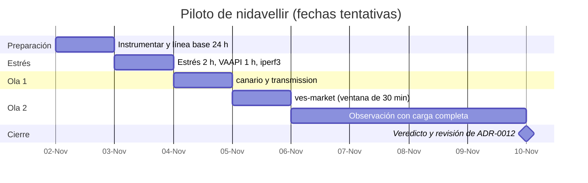
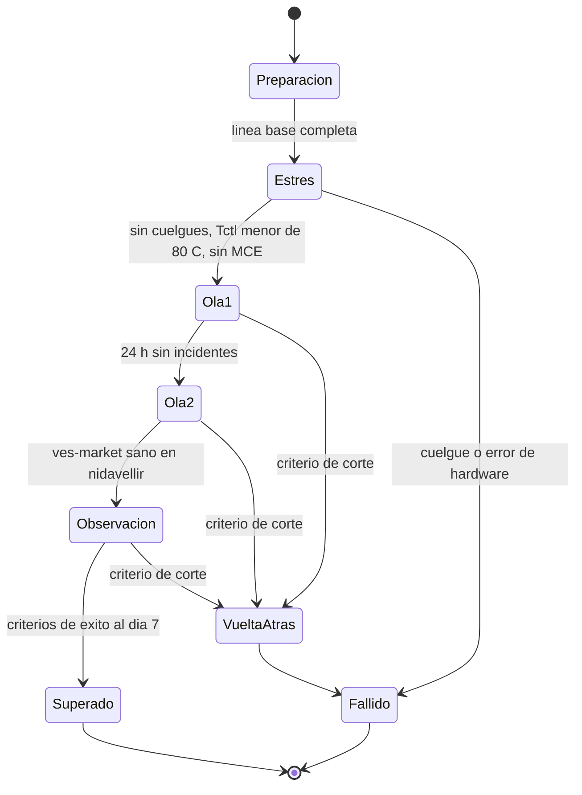

# Piloto de nidavellir: una semana con carga real

* **Estado:** draft
* **Fecha:** 2026-10-31
* **Decisores:** Jeremi
* **Fase AI-DLC:** 05-deployment
* **Versión:** 0.1.0
* **ADR:** [ADR-0012](../00-project/adr/ADR-0012-ubicacion-servicios-midgard-nidavellir.md)

## Objetivo

Decidir con datos si nidavellir puede ser el host de aplicaciones de la casa. El piloto responde a cuatro
preguntas:

1. **Estabilidad:** ¿aguanta una semana con carga real y una prueba de estrés sin cuelgues? De los 8
   cuelgues del 24 y 25-oct, alguno ocurrió con VAAPI y otros casi en reposo.
2. **Rendimiento:** ¿las aplicaciones movidas rinden igual o mejor que en midgard?
3. **Holgura:** ¿cuánta CPU, memoria y disco le quedan para la fase 2 (hive y morocota)?
4. **Operación:** ¿el despliegue continuo, los respaldos, Baldr y las alertas funcionan igual desde
   nidavellir?

## Alcance

| Ola | Qué se mueve | Por qué | Qué ejercita |
|---|---|---|---|
| — | Nada. Prueba de estrés y de VAAPI | Reproducir lo que lo colgaba antes de darle servicios | CPU, memoria, GPU, temperatura |
| 1 | **canario** y **transmission** | Riesgo mínimo: si fallan, solo se paran las descargas | Despliegue continuo con el reconciliador; red y NFS sostenidos |
| 2 | **ves-market** completo (9 contenedores y 13 GB de datos) | Es autocontenido (solo su red y su túnel) y es la carga más parecida a la de producción | Base de datos, disco, ingesta continua, túnel público |

**Fuera del piloto:** el router y Heimdall (ADR-0002), el stack de Yggdrasil (es el observador), hive y
morocota (dependen de la infraestructura compartida de midgard).

## Calendario

*Eje trazabilidad / plan · fase 05-deployment. La fecha de inicio la confirma Jeremi.*

Cada ola empieza solo si la anterior cumple sus criterios. Si una falla, se vuelve al estado anterior y
el piloto se da por terminado.

*Eje comportamiento · fase 05-deployment. Puertas entre olas.*

## Día 0: preparación

Nada se mueve todavía.

1. **Instrumentar nidavellir.** Thor ya publica temperatura, SMART, errores de disco y servicios, pero no
   CPU, memoria ni presión. Se instalan `sysstat` (muestra cada 10 min, como en midgard), `stress-ng` e
   `iperf3`.
2. **Desconectar el Samsung HD154UI** (`sda`, sin montar, 23 637 errores no corregibles). Un disco así
   puede provocar reinicios del bus SATA y contaminar el resultado. Necesita un apagado programado.
3. **Línea base de 24 h en midgard** de lo que se va a mover, para comparar:
   - filas por hora que escribe cada ingestor de ves-market;
   - latencia p50/p95 de `ves-api-gateway` con `curl` cada minuto desde el propio host;
   - CPU y memoria de cada contenedor (`docker stats`);
   - duración del respaldo diario de ves-market.
4. **Fijar la ventana de la ola 2:** 30 minutos sin ingesta crítica. `<TODO: Jeremi>`

## Día 1: estrés

| Prueba | Cómo | Pasa si |
|---|---|---|
| CPU, memoria y disco | `stress-ng --cpu 4 --vm 2 --vm-bytes 4G --hdd 1 --timeout 2h --metrics-brief` | Sin cuelgue; `Tctl` < 80 °C; sin MCE ni EDAC en `journalctl -k` |
| VAAPI | Dos transcodificaciones simultáneas en Bragi durante 1 h | Sin cuelgue ni errores de `amdgpu` |
| Red LAN | `iperf3` entre midgard y nidavellir, 60 s en cada sentido | ≥ 900 Mbit/s; sin errores en `ip -s link show enp3s0` |

## Día 2: ola 1, canario y transmission

1. **canario:** se quita de `apps.yml` del receptor de midgard y se declara en el de nidavellir, como se
   hizo con Bragi el 26-oct. El reconciliador lo despliega sin webhook. Un push a canario comprueba el
   camino completo.
2. **transmission:** `docker compose stop` en midgard (sin `down -v`), y se copia la configuración a
   nidavellir. La interfaz web escucha en `192.168.10.2:9091` y las descargas siguen en el NAS, que nidavellir ya monta.
   El puerto entrante 51413 está abierto en el NAT de midgard hacia midgard. Hay que redirigirlo a
   nidavellir o aceptar que en el piloto no haya conexiones entrantes. `<TODO: Jeremi>`

## Día 3: ola 2, ves-market

1. En la ventana fijada: parar ves-market en midgard (`docker compose stop`; **nunca** `down -v`), y
   deshabilitar sus temporizadores de host (`ves-market-arranque`, `ves-market-respaldo-nas` y
   `ves-market-vigia`).
2. Copiar los volúmenes `ves_market_datos` (12,7 GB), `ves-market-infra_timescale-data`,
   `ves-market-infra_rabbitmq-data` y `ves_respaldo_estado` por la LAN (~3 min a 1 Gbit/s). Comparar
   el tamaño y un recuento de filas por hipertabla en origen y destino.
3. Declarar las 6 apps de ves-market en el receptor de nidavellir y quitarlas del de midgard. Instalar
   en nidavellir las unidades de host del repo `ves-market-watch` y añadir ves-market a `BALDR_JOBS` y
   `BALDR_MONTAJES`.
4. Arrancar y comprobar: los contenedores sanos; el túnel de Cloudflare conectado; la SPA y la API
   responden desde fuera; los ingestores escriben filas nuevas.
5. **Los volúmenes de midgard no se borran** hasta el veredicto. Son la vuelta atrás.

## Días 3 a 7: observación

Revisión diaria, con un parte en el chat:
- arranques del día (`journalctl --list-boots`);
- `journalctl -k`: MCE, EDAC, lockups, I/O errors, `r8169`, `amdgpu`;
- `sar -u -r -q -d -n EDEV` del día;
- `/proc/pressure/*`;
- SMART del disco de sistema frente a la línea base;
- `docker ps` (salud) y las alertas activas en Gjallarhorn;
- las mismas métricas de ves-market que en la línea base.

Para atribuir bien los cortes del túnel público de ves-market, se miran también los registros de
`pia-tunel` y `wan-balancer` en midgard. Un corte de las WAN o de PIA no cuenta contra nidavellir.

## Criterios

**Corte inmediato** (vuelta atrás y piloto fallido):
- un cuelgue o reinicio no planificado de nidavellir que no sea un apagón;
- un error de hardware: MCE, EDAC, o un I/O error nuevo en el disco de sistema;
- pérdida de datos de ves-market, o un hueco de ingesta de más de 30 min por causa de nidavellir.

**Éxito al día 7** (se cumplen todos):

| Pregunta | Criterio |
|---|---|
| Estabilidad | 0 cuelgues; 0 MCE/EDAC/lockups; SMART del disco de sistema sin cambios |
| Rendimiento | API de ves-market con p95 ≤ el de la línea base de midgard; ingesta sin huecos atribuibles al host; respaldo diario completo |
| Holgura | Memoria disponible ≥ 6 GB; CPU media < 40 %; PSI `some avg300` < 5 % en CPU, memoria y E/S; disco de sistema ≥ 40 % libre |
| Operación | Un despliegue por el reconciliador; el respaldo al NAS; Baldr tras un reinicio planificado; alertas visibles en Hlidskjalf |

## Vuelta atrás

1. Parar en nidavellir lo movido (`docker compose stop`).
2. Si ves-market escribió datos en nidavellir, copiar sus volúmenes de vuelta a midgard. Si no, basta con
   los que se dejaron intactos.
3. Volver a declarar las apps en el receptor de midgard, quitarlas del de nidavellir y rehabilitar los
   temporizadores de host.
4. `docker compose start` en midgard y comprobar la salud, el túnel y la ingesta.

Tiempo estimado: 20 min para ves-market y 5 min para el resto.

## Después del piloto

- **Superado:** ADR-0012 pasa a `accepted`. Se abre una revisión para la fase 2 (hive, morocota y la
  infraestructura compartida) y se empiezan a contar las 4 semanas del criterio del router.
- **Fallido:** todo vuelve a midgard. nidavellir sigue solo con Bragi y hive-idp mientras se diagnostica:
  primero la RAM, de módulo en módulo con memtest86+. ADR-0012 se revisa con el motivo.
